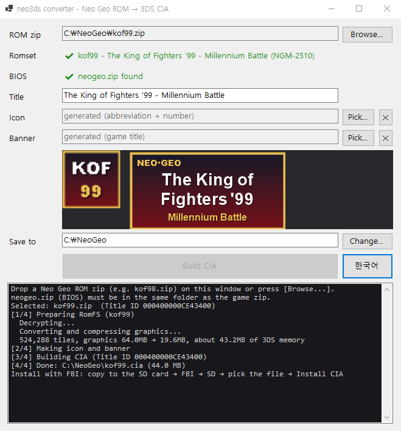
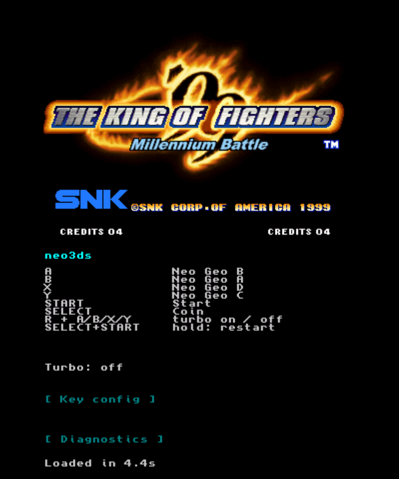
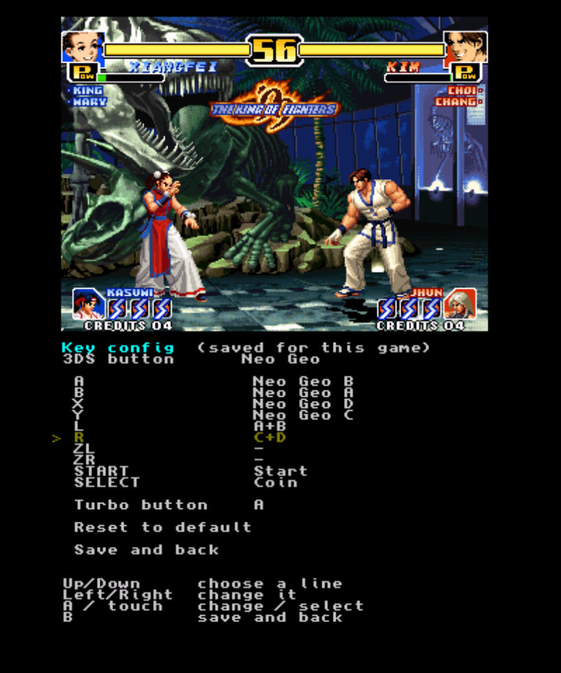
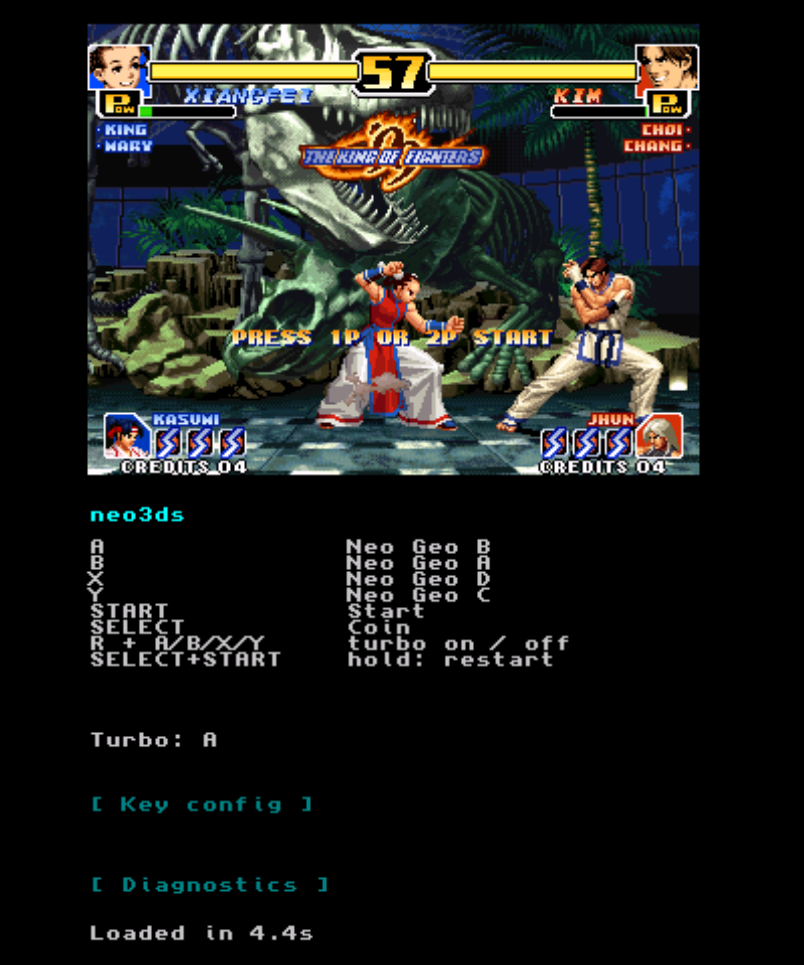
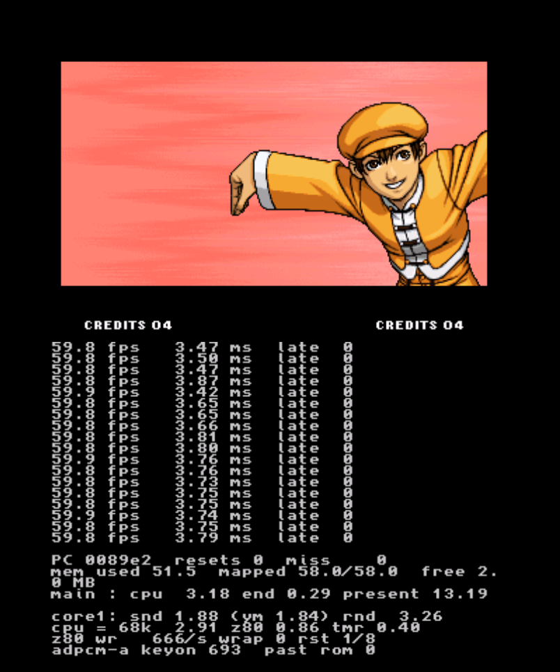

# neo3ds

**A converter that turns Neo Geo games into full-speed 3DS titles, even on the original (Old) 3DS.**
Give it a Neo Geo ROM zip on your PC and it builds a 3DS install file (CIA) with the emulator inside.
Each game gets its own HOME menu icon and starts straight away. New 3DS models run it with room to spare.

[한국어](README.md) · [Download the converter](https://github.com/zzcx88/neo3ds/releases/latest/download/neo3ds-converter.zip)

| Metal Slug 3 (Old 3DS hardware) | KOF '99 (Old 3DS hardware) |
|---|---|
| [](https://youtube.com/shorts/tM-fU44WTpA) | [](https://youtube.com/shorts/EF6eDKhlq-E) |
| Click to watch on YouTube (41 s) | Click to watch on YouTube (66 s) |

## Features

- **60 fps on an Old 3DS (268 MHz)**: verified on hardware with KOF98, KOF99, KOF2000, KOF2002, Metal Slug X, Metal Slug 3 and SVC Chaos.
- **One CIA per game** with its own HOME menu icon. No launcher in between.
- **Fast start and exit**: runs in the 3DS's default 64 MB memory mode, so there is no system reload when a game starts or quits.
- **Plain MAME romsets**: knows all 282 MAME Neo Geo romsets and converts 240 of them. Encrypted later games (KOF99, Garou, Metal Slug 3-5, KOF2000-2003, SVC Chaos...) are decrypted during conversion.
- **Key config**: map each button to a Neo Geo button or a combination (A+B...), saved per game.
- **Turbo (rapid fire)**: R + a face button toggles it; 20 presses a second.
- **Restart**: hold SELECT + START for a second to restart the game.
- **Generated icon and banner** from the game title, or use your own pictures.
- Converter in **English and Korean**.

## What you need

| | |
|---|---|
| 3DS | Old 3DS / 2DS / New 3DS / New 2DS XL with [Luma3DS](https://github.com/LumaTeam/Luma3DS) custom firmware and a CIA installer such as [FBI](https://github.com/lifehackerhansol/FBI). |
| PC | Windows 10/11, 64-bit (no .NET install needed) |
| ROMs | **MAME romset zips** of games you own, plus **neogeo.zip (BIOS)**. No ROMs are included here. |
| Sound | `/3ds/dspfirm.cdc` on the SD card (dump it once with DSP1). |

## How to use

### 1. Get the converter
Download [neo3ds-converter.zip](https://github.com/zzcx88/neo3ds/releases/latest/download/neo3ds-converter.zip) and unzip it anywhere.
Keep `Neo3dsConverter.exe` and its `tools` folder together.

### 2. Build a CIA



1. Put the game zip and `neogeo.zip` in the **same folder**. Keep the MAME file names (`kof99.zip`, `mslug3.zip`...).
2. Run `Neo3dsConverter.exe` and drop the game zip on the window, or press **[Browse...]**.
3. If the **Romset** line turns green, the game can be converted. If it is red, the reason is shown.
4. Change the **Title**, **Icon** or **Banner** if you like. The preview shows the HOME menu art as it will be built.
5. Press **[Build CIA]**. A game takes a minute or two (graphics compression).

The **[한국어]** button next to it switches the window to Korean.

Examples of the generated icons (abbreviation + series number) and banners (game title), sized so no text is cut off:


### 3. Install on the 3DS
Copy the `.cia` to the SD card, then in FBI: SD → pick the file → **Install CIA**. The game appears on the HOME menu.

### Command line
```
Neo3dsConverter.exe <game.zip> [out-dir] [--title "Name"] [--icon pic.png] [--banner pic.png] [--set romset] [--lang ko|en]
```
- `--set` picks another version inside a merged zip (e.g. `kof98.zip --set kof98h`).
- `--icon` / `--banner`: pictures for the icon (48×48) and banner (256×128); other sizes are scaled and cropped to fit.

## Controls



These are the defaults. Buttons can be changed per game in [Key config](#key-config), and the bottom screen shows the current layout.

| 3DS | Neo Geo |
|---|---|
| D-pad / Circle Pad | Joystick |
| B / A / Y / X | A / B / C / D |
| SELECT | Coin |
| START | Start |
| R + B/A/Y/X | Turbo on/off (see below) |
| Hold SELECT + START for 1 s | Restart the game |
| Touch `[ Key config ]` on the bottom screen | Key config |
| Touch `[ Diagnostics ]` on the bottom screen | Diagnostics |

**Restart**: holding SELECT and START together for a second restarts the game as if the console were switched off and on (the cartridge's save data is kept). While both are held, they don't reach the game as coin and start.

## Key config



Touch `[ Key config ]` on the bottom screen; the game pauses and the config screen opens.

- Each of A / B / X / Y / L / R / ZL / ZR / START / SELECT can press **Neo Geo A-D, a combination (A+B, C+D, B+C, A+B+C, B+C+D, A+B+C+D), Start or Coin**. For example in KOF: L = A+B (dodge), R = C+D (blowback).
- Up/Down picks a line, Left/Right (or A, or a touch) changes it. The **turbo button** can be set here too.
- **B** or `Save and back` saves and returns to the game. `Reset to default` restores the default layout.
- Settings are saved **per game** on the SD card in `/3ds/neo3ds/keys/` and kept across launches.

## Turbo (rapid fire)



- **Hold R and press A, B, X or Y** to make that button the turbo button.
- Hold R and press **the same button again** to turn turbo off, or **another button** to move turbo there. Only one button has turbo at a time.
- **While you hold** the turbo button it is pressed and released 20 times a second. Single taps still fire once.
- The bottom screen shows the state: `Turbo: A` or `Turbo: off`.
- While R is held, A/B/X/Y don't reach the game, so setting turbo never makes your character act.
- Turbo set with R + button lasts for this session; set it in Key config to keep it. If R is mapped to something, turbo can only be changed in Key config.

## Diagnostics



Touch `[ Diagnostics ]` on the bottom screen for a once-a-second report: fps, main-core time (68000, Z80, timers), second-core time (sound, drawing) and memory use. Touch again to go back to the controls.

## Compatibility


### Verified on an Old 3DS

| Game | Romset | Result |
|---|---|---|
| The King of Fighters '98 | `kof98` (converted as the home version `kof98h`) | Full speed, no drops in fights |
| The King of Fighters '99 | `kof99` (SMA + CMC42 decrypted) | Full speed |
| Metal Slug 2 | `mslug2` | Playable; slows down where the original board also did |
| Metal Slug X | `mslugx` (protection checks patched) | Full speed |
| Metal Slug 3 | `mslug3` (SMA + CMC42 decrypted) | Full speed |
| The King of Fighters 2000 | `kof2000` (SMA + CMC50 decrypted) | Full speed |
| The King of Fighters 2002 | `kof2002` (PCM2 + CMC50 decrypted) | Full speed |
| SNK vs. Capcom: SVC Chaos | `svc` (PVC + PCM2 + CMC50 decrypted) | Full speed |

### Converts, but not tried on hardware
- **Most unencrypted games** (1990-1999): KOF94-97, Fatal Fury series (except 2), Samurai Shodown 1-4, World Heroes, The Last Blade 1/2, Metal Slug 1, Blazing Star, Puzzle Bobble and more. They convert the same way as the verified games.
- **Decryption implemented, never run (no ROMs to test)**
  - CMC42: Garou, Sengoku 3, Zupapa!, Strikers 1945 Plus, Prehistoric Isle 2, Nightmare in the Dark, Ganryu, Bang Bead
  - CMC50: KOF2001
  - PCM2: Metal Slug 4 / 4 Plus, Rage of the Dragons, Pochi and Nyaa
  - KOF2002 type (KOF2002 itself verified): 2002 Plus, Samurai Shodown V / V Special, Matrimelee
  - PVC (SVC Chaos verified): Metal Slug 5, KOF2003

Their memory use should be close to KOF99 and Metal Slug 3, whose ROMs are the same size (about 53 MB of 58 MB). The converter warns when memory gets tight.

### Can't be converted

| Reason | Romsets |
|---|---|
| Protection chip not supported | Fatal Fury 2 (`fatfury2`), Super Sidekicks (`ssideki`) |
| MVS protection chip | KOF98 MVS sets (`kof98`, `kof98a`, `kof98k`, `kof98ka`). A merged `kof98.zip` converts as the home version `kof98h` automatically |
| Special controller | The Irritating Maze (`irrmaze`, trackball) |
| Gambling boards | V-Liner (`vliner` sets), Jockey Grand Prix (`jockeygp` sets) |
| Bootlegs | 28 sets such as `kof10th`, `kf2k2mp`, `kof2002b`, `cthd2003`, `ms5plus`, `svcboot`, `kf2k3bl`, `mslug3b6`, `kog`, `sbp` |

Mahjong games lack mahjong panel input, and the 4-player `kizuna4p` plays with two players.

## 64 MB mode and the optimizations

An Old 3DS has two 268 MHz ARM11 cores, and apps get 64 MB in the default memory mode.
The 80 MB mode has more room but makes the system reload every time a game starts or exits, which is slow.
So the goal was to **fit 64 MB graphics ROMs into the default 64 MB mode**.

### Memory
- **Compressed graphics**: the sprite ROM (up to 64 MB) is zstd-compressed (level 19) in 4 KB blocks, to about 30% (KOF99: 64 MB → 19.6 MB).
- **8 MB block cache**: only the blocks on screen are unpacked. Fully transparent tiles are skipped using a usage table, so they are never read.
- **Heap layout**: 58 MB heap and 2 MB linear memory for the screen. KOF99 uses 51.5 MB.
- **Decrypted ahead of time**: encrypted ROMs are decrypted on the PC, costing the 3DS neither memory nor time.

### Speed
- **Two cores**: the main core runs only the 68000, Z80 and timers; the second core synthesizes sound and draws the screen.
- **Split sound chip**: the YM2610 runs as two copies. The main-core copy handles timers, interrupts and status; the second-core copy replays the logged register writes to make the sound.
- **Sprite renderer**: unzoomed sprites are drawn tile by tile, and opaque 8-pixel runs are written by ARM assembly in one go, straight into the 3DS's rotated framebuffer.
- **Output**: the CPU draws into the framebuffer (no GPU round trip) with triple buffering, so nothing tears. Cache flushes use an SVC directly instead of a system service, so the second core never stalls waiting on one.
- **Visible area only**: draws the Neo Geo's real 304×224 picture.
- **BIOS**: uses the home (AES) BIOS from neogeo.zip when present, otherwise an arcade (MVS) BIOS.

New 3DS models are set to 804 MHz with the L2 cache on, for plenty of headroom (not tested on hardware).

## Building from source

- Engine: [devkitPro](https://devkitpro.org/) (devkitARM, libctru). `bash scripts/build_engine.sh` → `engine/engine.elf`
- Converter: .NET 10 SDK. `dotnet build -c Release converter/Neo3dsConverter`
- The converter bundles `tools/makerom/makerom.exe` and `tools/bannertool/windows-x86_64/bannertool.exe`; get them from the [makerom](https://github.com/3DSGuy/Project_CTR) and [bannertool](https://github.com/diasurgical/bannertool) releases.
- Game DB: fetch MAME's `src/mame/snk/neogeo.cpp` and run `py scripts/gen_gamedb.py neogeo.cpp converter/assets/neogeo_games.json`.

## Legal

- This repository and its releases contain **no ROMs, BIOS or game data**. You need ROMs of games you own.
- The CIAs you build contain ROM data: **do not share them.**
- neo3ds is for **non-commercial use only**, because its CPU cores (Cyclone 68000, DrZ80) are licensed for non-commercial use only.
- The source code is GPL-2.0 ([LICENSE](LICENSE)). Third-party code and licenses are listed in [THIRD_PARTY_NOTICES.md](THIRD_PARTY_NOTICES.md).
- NEOGEO and SNK are trademarks of SNK CORPORATION; Nintendo 3DS is a trademark of Nintendo. neo3ds is an independent fan project, not affiliated with either. Game footage and screenshots belong to their respective owners.

## Thanks

gngeo (Peponas Mathieu), Cyclone 68000 (Dave, notaz), DrZ80 (Reesy), the MAME team (romset data and cart decryption research), Zstandard, devkitPro / libctru, makerom, bannertool, and Azahar (testing during development).
