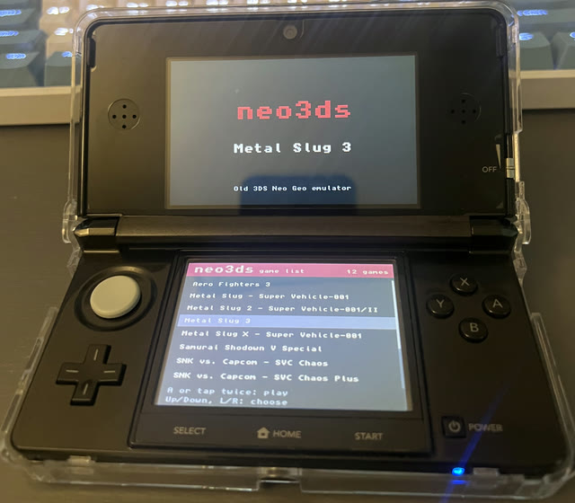
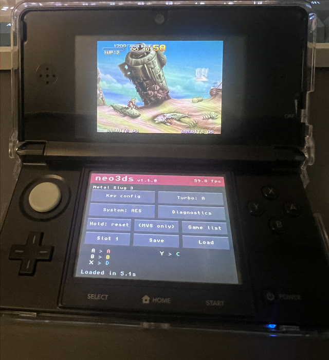
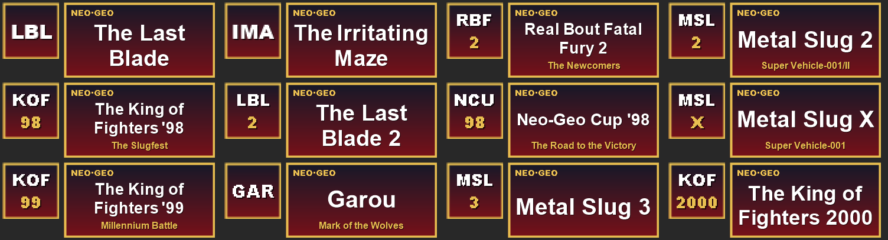
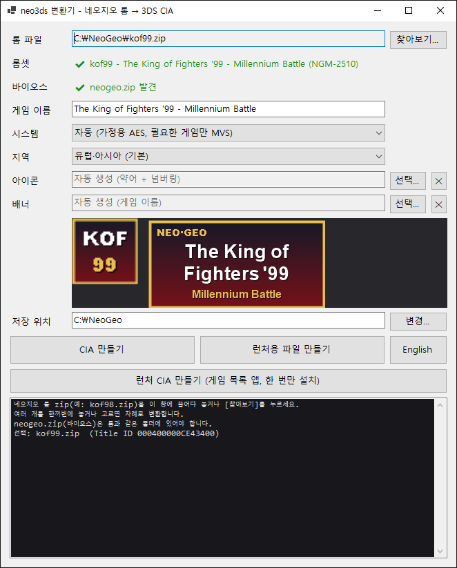
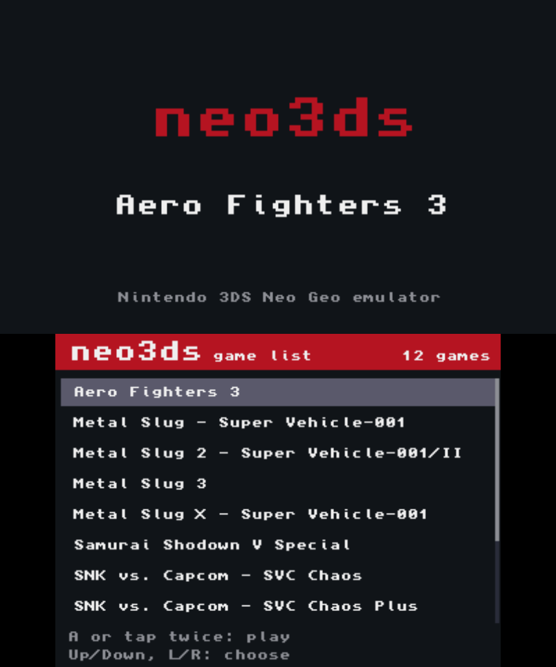
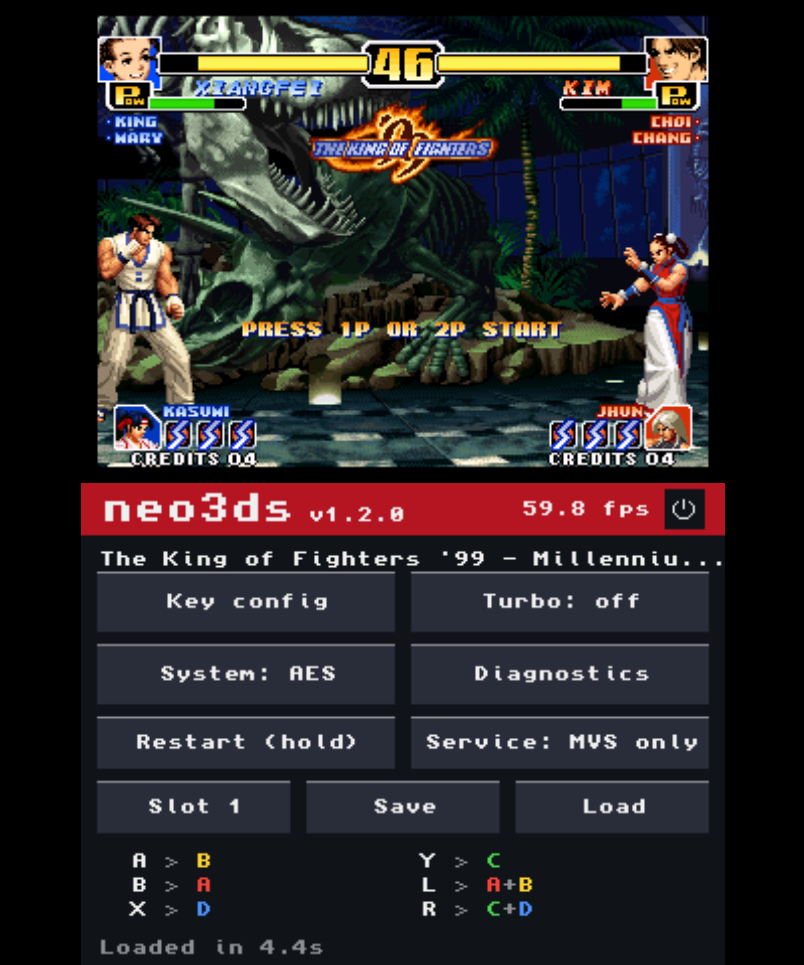
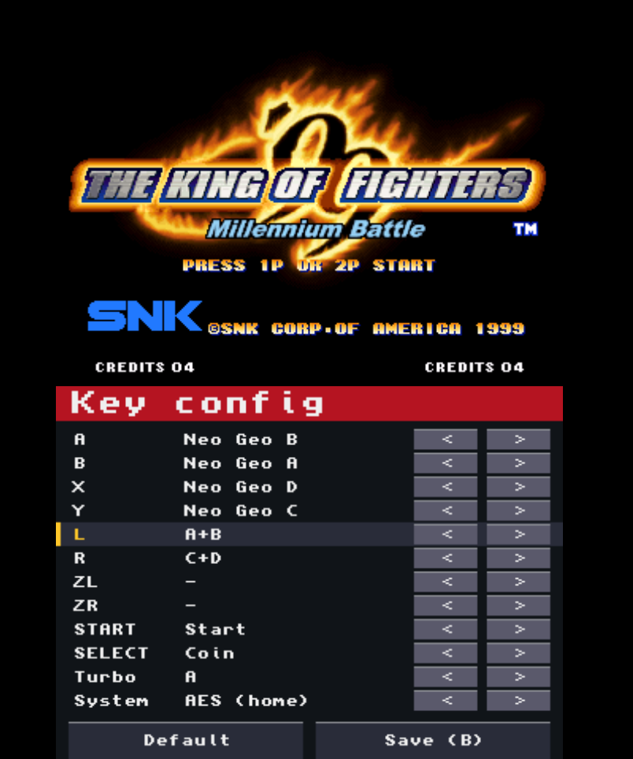
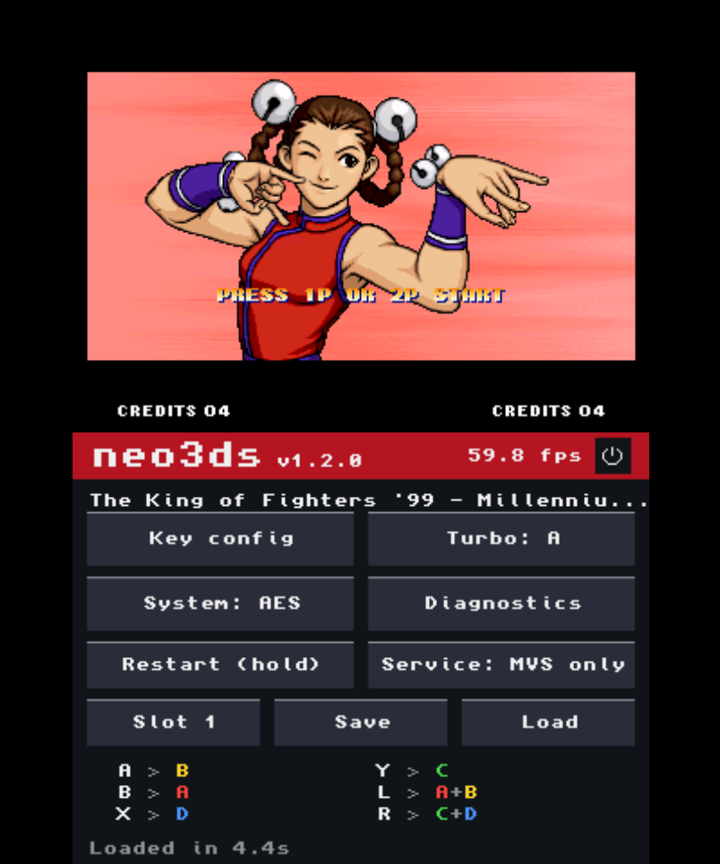
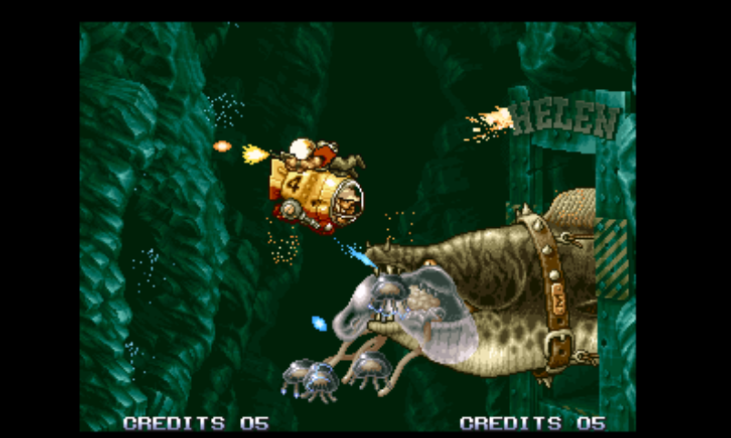

# neo3ds - NeoGeo emulator for Nintendo 3DS

**구형 3DS에서도 풀 스피드로 돌아가는 네오지오 에뮬레이터입니다.** MAME 롬셋을 브라우저에서 변환해 SD 카드에 넣고, 게임 목록에서 골라 바로 실행합니다.

[소개 페이지](https://zzcx88.github.io/neo3ds/ko/) · [**웹 변환기**](https://zzcx88.github.io/neo3ds/ko/convert.html) · [릴리스](https://github.com/zzcx88/neo3ds/releases/latest) · [호환 목록](https://zzcx88.github.io/neo3ds/ko/compat.html) · [English](README.md)

| 런처 게임 목록 (구형 3DS 실기) | 메탈슬러그 3 (구형 3DS 실기) |
|---|---|
|  |  |

## neo3ds의 장점

- **268MHz 구형 3DS에서 60fps.** KOF '95~2002, 메탈슬러그 1·X·3·5, SVC Chaos, 사무라이 쇼다운 5 스페셜이 실기에서 프레임 스킵 없이 풀 스피드로 돌아갑니다.
- **켜고 끄는 게 바로바로.** 3DS 기본 메모리 모드(64MB) 안에 다 들어가서, 게임을 켜고 끌 때 시스템 재로딩이 없습니다.
- **PC에 설치할 것이 없습니다.** 웹 변환기는 브라우저 안에서 돌고, 롬은 브라우저 밖으로 나가지 않습니다. 원하면 Windows·Linux·macOS용 오프라인 변환기도 있습니다.
- **MAME 롬셋 그대로.** MAME 네오지오 롬셋 282종 중 242종을 변환합니다. 암호화된 후기 게임(KOF99~2003, 가로우, 메탈슬러그 3~5, SVC Chaos)도 변환할 때 해독합니다.
- **런처 하나, 업데이트도 한 번.** 런처 앱을 설치하고 `.neo3ds` 게임 파일을 SD 카드에 넣으면 됩니다. 새 버전은 런처만 다시 설치합니다. 게임마다 HOME 메뉴 아이콘을 두는 게임별 CIA도 만들 수 있습니다.
- **휴대기에 맞춘 기능.** 퀵세이브, 동시 누르기까지 되는 게임별 키 설정, 연사, 풀스크린, 아래 화면 끄기, 아케이드 바이오스 서비스 메뉴를 아래 화면 터치 버튼으로 다룹니다.

**1.4 새 기능**: 아케이드(MVS) 바이오스로 시작할 때 보드 점검을 빨리 감아 몇 초 안에 게임이 시작합니다. 1.3: 런처 즐겨찾기, 화면 중간 래스터 효과(네오 터프 마스터즈, 네오 드리프트 아웃), Linux·macOS 창 변환기. [패치노트](https://zzcx88.github.io/neo3ds/ko/changelog.html)

## 빠른 시작

1. **3DS 준비**: [Luma3DS](https://github.com/LumaTeam/Luma3DS) 커스텀 펌웨어, [FBI](https://github.com/lifehackerhansol/FBI) 같은 CIA 설치 앱, 소리용 `/3ds/dspfirm.cdc`(DSP1로 한 번 덤프).
2. **런처 받기**: [웹 변환기](https://zzcx88.github.io/neo3ds/ko/convert.html)에서 런처 CIA를 만들어 FBI로 설치합니다. 한 번만 하면 됩니다.
3. **게임 변환**: MAME 롬셋 zip을 `neogeo.zip`(바이오스)과 함께 넣고 **런처용 파일**(`.neo3ds`)로 만듭니다.
4. **실행**: `.neo3ds` 파일을 SD 카드 `/neo3ds/games/`에 넣고 런처를 켭니다.

본인이 가진 게임의 MAME 롬셋 zip과 `neogeo.zip`이 필요합니다. 이 저장소에는 롬이 들어 있지 않습니다. 파일 이름이나 칩 CRC가 MAME와 다른 롬셋은 변환되지 않습니다.

## 변환하기

### 웹 변환기 (권장)

Chrome, Edge, Firefox, Safari에서 됩니다. 테스트 PC에서 KOF '98 변환에 약 7초 걸렸습니다.

1. [웹 변환기](https://zzcx88.github.io/neo3ds/ko/convert.html)를 열고 게임 zip과 `neogeo.zip`을 함께 넣습니다. MAME 파일 이름(`kof99.zip`, `mslug3.zip` 등)은 그대로 둡니다. 합본(merged) 롬셋이면 부모 zip도 같이 넣습니다.
2. zip이 여러 개면 인식된 게임과 변환할 수 없는 이유(모르는 롬셋, 칩 누락, `neogeo.zip` 없음, 미지원 카트)가 목록으로 나옵니다. 변환할 수 있는 게임만 변환하고, 한 게임이 실패해도 나머지는 계속합니다.
3. 결과물을 고릅니다: **런처용 파일**(`.neo3ds`), **CIA**(게임마다 HOME 메뉴 앱 하나), **런처 CIA**(런처 앱).
4. 필요하면 **시스템**과 **지역**을 바꿉니다.
   - **시스템**은 게임이 켜질 바이오스입니다. 자동이면 가정용(AES)이고, 아케이드(MVS)는 아케이드 기판용으로 고친 게임에만 씁니다. 3DS에서도 바꿀 수 있습니다.
   - **지역**은 게임이 보는 본체 지역입니다(기본 유럽·아시아). **일본**으로 하면 메탈슬러그의 피 표현처럼 일본판에만 있는 내용이 나옵니다.
5. CIA는 변환 전에 자동 생성된 **아이콘·배너**를 원하는 그림으로 바꿀 수 있습니다(게임 줄을 눌러 그 게임만). 그림은 가운데 기준으로 48×48 / 256×128로 자릅니다.
6. 만들기 버튼을 누르고 결과를 하나씩 받거나 **[전체 다운로드 (N)]** 로 ZIP 하나에 받습니다.



### 오프라인 변환기 (선택)

같은 변환기를 PC 프로그램으로 쓰는 방법입니다. 창과 명령줄을 모두 지원하고, 게임 **이름**도 바꿀 수 있습니다. .NET 런타임은 설치할 필요가 없고, 압축을 푼 폴더는 그대로 둡니다.

| PC | 받기 |
|---|---|
| Windows 10/11 64비트 | [neo3ds-converter.zip](https://github.com/zzcx88/neo3ds/releases/latest/download/neo3ds-converter.zip) |
| Linux x64 | [neo3ds-converter-linux-x64.zip](https://github.com/zzcx88/neo3ds/releases/latest/download/neo3ds-converter-linux-x64.zip) |
| macOS (Apple Silicon) | [neo3ds-converter-osx-arm64.zip](https://github.com/zzcx88/neo3ds/releases/latest/download/neo3ds-converter-osx-arm64.zip) |



1. 압축을 풀고 `Neo3dsConverter.exe`(Windows), `neo3ds-converter`(Linux), `neo3ds-converter.app`(macOS, `~/Downloads` 밖으로 먼저 옮김 — *OS별 첫 실행* 참고)을 실행합니다.
2. 게임 zip을 창에 끌어 놓거나(`neogeo.zip`은 같은 폴더에) 찾아보기 버튼으로 엽니다.
3. 롬셋이 인식되면 필요에 따라 이름·시스템·지역·아이콘·배너를 바꿉니다. 미리보기가 실제 HOME 메뉴 모양입니다.
4. **CIA**, **런처용 파일**, **런처 CIA** 중 하나를 만듭니다. Windows는 zip 옆에, Linux·macOS는 `~/Downloads`에 저장합니다.

언어 버튼으로 한국어와 영어를 바꿉니다.

<details>
<summary>OS별 첫 실행</summary>

- **Windows**: "알 수 없는 게시자" 경고가 나오면 **[추가 정보] → [실행]**을 누릅니다.
- **macOS**: 앱을 **처음 실행하기 전에** `neo3ds-converter.app`을 `~/Applications`나 `/Applications`로 옮깁니다. 또는 `neo3ds-converter-osx-arm64` 폴더가 있는 자리에서 터미널로 `xattr -dr com.apple.quarantine neo3ds-converter-osx-arm64`를 한 번 실행합니다. `~/Downloads`에서 바로 실행하면 macOS가 앱을 읽기 전용 App Translocation 사본에서 돌립니다. 변환기 v1.3.1 이하에서는 이 상태로 CIA를 만들면 `Read-only file system : '…/AppTranslocation/…/tools/osx-arm64/bannertool'`로 실패합니다. 서명되지 않은 앱이라 경고가 나오면 **열기**를 누릅니다.
- **Linux**: `libx11-6`, `libice6`, `libsm6`, `libfontconfig1`이 필요합니다(Ubuntu 기준). Xubuntu 26.10(X11)에서 확인했습니다. 아이콘·배너의 한글 제목은 시스템 글꼴로 그리므로 `fonts-noto-cjk` 같은 한글 글꼴을 설치하세요. X11/XWayland에서 돌고, Wayland 네이티브는 지원하지 않습니다.
- **미지원**: Intel Mac, linux-arm64.

</details>

<details>
<summary>명령줄</summary>

Windows는 `Neo3dsConverter.exe`, Linux·macOS는 `./neo3ds-converter`로 같은 옵션을 씁니다.

```
neo3ds-converter <game.zip> [game2.zip ...] [out-dir] [--title "Name"] [--icon pic.png] [--banner pic.png] [--set romset] [--system aes|mvs] [--region eu|jp|us] [--pack] [--lang ko|en]
neo3ds-converter --launcher [out-dir]
neo3ds-converter --help
```

- zip 여러 개는 차례로 변환합니다(`--title`, `--icon`, `--banner`, `--set`은 zip 하나일 때만).
- `--set`: 합본 zip 안의 다른 판을 고릅니다(예: `kof98.zip --set kof98h`).
- `--system`: 가정용 `aes` / 아케이드 `mvs`. 빼면 자동.
- `--region`: 유럽·아시아 `eu`, 일본 `jp`, 미국 `us`. 빼면 `eu`.
- `--pack`은 CIA 대신 `.neo3ds` 파일을, `--launcher`는 `neo3ds-launcher.cia`를 만듭니다.
- `--icon` / `--banner`: 아이콘 48×48, 배너 256×128. 다른 크기는 맞춰 줄이고 자릅니다.
- `--lang`: `ko` / `en`. 창 화면에도 기억됩니다.

</details>

## 3DS에서

그림과 함께 정리한 [3DS 사용 안내](https://zzcx88.github.io/neo3ds/ko/manual.html)가 있습니다.

### 런처



- 십자키 위/아래(L/R은 한 페이지씩)나 터치로 고르고, **A**나 **두 번 터치**로 실행합니다.
- **즐겨찾기**: **SELECT**를 누르거나 게임 왼쪽 `*`를 터치하면 넣고 뺍니다. 십자키 왼쪽/오른쪽이나 탭 터치로 **All**과 **Fav**를 바꿉니다.
- 게임 중에 아래 화면 **[Game list]** 를 두 번 누르면 목록으로 돌아갑니다.

**업데이트는 런처만.** 엔진이 런처 안에 있어서, 이미 만든 `.neo3ds` 파일은 새 버전에서도 그대로 돌아갑니다. 게임별 CIA는 엔진이 각자 들어 있어서 다시 변환해야 합니다. 키 설정과 백업 RAM은 유지되고, 다른 버전의 퀵세이브는 불러올 수 없습니다.

게임별 CIA를 쓰려면 `.cia`를 SD 카드에 넣고 FBI에서 설치합니다(SD → 파일 → **Install CIA**). 같은 게임은 CIA와 런처가 키 설정·백업 RAM·퀵세이브를 함께 씁니다.

### 조작



| 3DS | 네오지오 |
|---|---|
| 십자키 | 조이스틱 |
| B / A / Y / X | A / B / C / D |
| SELECT / START | 코인 / 스타트 |
| R + B/A/Y/X | 연사 켜기/끄기 |
| SELECT + L / SELECT + R | 퀵세이브 / 불러오기 |
| SELECT + START 1초 | 게임 재시작 |

기본 배치입니다. [키 설정](#키-설정)에서 게임마다 바꿀 수 있습니다. 아래 화면에 지금 배치가 실제 기판 버튼 색(A 빨강, B 노랑, C 초록, D 파랑)으로 나오고, 맨 위에 게임 이름과 FPS가 나옵니다.

### 아래 화면

| 버튼 | 하는 일 |
|---|---|
| **Key config** | 키 설정 화면을 엽니다(게임이 멈춤) |
| **Turbo** | 누를 때마다 연사 끔 → A → B → X → Y |
| **System** | 가정용(AES)과 아케이드(MVS) 바이오스를 바꿉니다. 두 번 누르면 그 바이오스로 다시 시작 |
| **Diagnostics** | 1초마다 FPS·코어별 시간·메모리 사용량. 터치하면 돌아감 |
| **Restart** | 노란 막대가 찰 때까지 누르면 재시작. 전원을 껐다 켠 것과 같음(기판 세이브는 유지) |
| **Service** | MVS 바이오스 서비스 메뉴(난이도·크레딧·하드웨어 테스트). MVS 전용 |
| **Slot / Save / Load** | 퀵세이브: 슬롯 1~3 고르기, 저장, 불러오기(두 번 누름) |
| **Game list** | 런처로 실행했을 때만: 두 번 누르면 게임 목록으로 |
| **⏻** | 아래 화면 백라이트를 끕니다. 아무 데나 터치하면 다시 켜짐(그 터치는 눌리지 않음) |

### 키 설정



- A / B / X / Y / L / R / ZL / ZR / START / SELECT 각각에 **네오지오 A~D, 동시 누르기(A+B, C+D, B+C, A+B+C, B+C+D, A+B+C+D), 스타트, 코인**을 지정합니다. 예를 들어 KOF에서 L = A+B(회피), R = C+D(날리기).
- 줄 끝의 `<` `>`를 누르거나, 위/아래로 줄을 고르고 좌/우로 바꿉니다. 연사 버튼도 여기서 정합니다.
- **System**은 바이오스를 바꿉니다(저장하면 다시 시작). MVS에서는 SELECT로 코인을 넣어야 시작합니다.
- **Screen**: `Original (1:1)`은 304×224 그대로, `Full (stretched)`는 위 화면 400×240을 가득 채웁니다(가로 약 1.3배, 세로 약 1.07배라 일부 도트가 두 배 폭으로 보임).
- **B** 또는 `Save (B)`로 저장하고 돌아갑니다. `Default`는 기본값으로 되돌립니다. 설정은 게임마다 저장됩니다.



**연사**: R을 누른 채 A/B/X/Y를 누르면 그 버튼이 연사 버튼이 됩니다(같은 버튼을 다시 누르면 꺼짐). 누르고 있으면 초당 20회, 톡톡 누르면 한 발씩 나갑니다. R + 버튼으로 바꾼 연사는 그 판에만 적용되고, 계속 쓰려면 키 설정에서 정합니다.

**퀵세이브**: 게임마다 슬롯 3개에 지금 상태를 그대로 저장합니다. 다른 바이오스에서 저장한 슬롯은 그 바이오스로 바꾼 뒤 불러옵니다.

**백업 RAM**: MVS 바이오스에서 기판의 설정·하이스코어·랭킹 이니셜을 SD 카드에 저장합니다. 바뀌었을 때, 그리고 HOME·닫기·절전 때 바로 저장합니다.

<details>
<summary>저장 위치</summary>

| 파일 | SD 카드 경로 |
|---|---|
| 키 설정 | `/3ds/neo3ds/keys/<타이틀 ID>.bin` |
| 백업 RAM | `/3ds/neo3ds/saves/<타이틀 ID>.sram` |
| 퀵세이브 | `/3ds/neo3ds/states/<타이틀 ID>.1` ~ `.3` |
| 런처용 게임 파일 | `/neo3ds/games/*.neo3ds` |
| 런처 즐겨찾기 | `/3ds/neo3ds/launcher.txt` |

타이틀 ID는 롬셋 이름(zip 이름)으로 정해지므로, 같은 zip으로 다시 만들거나 런처로 실행해도 같은 파일을 씁니다.

</details>

## 호환성



롬셋 282종 전체는 [호환 목록](https://zzcx88.github.io/neo3ds/ko/compat.html)에 있습니다. 구형 3DS 실기에서 돌려 본 게임:

| 게임 | 롬셋 | 결과 |
|---|---|---|
| The King of Fighters '95 | `kof95` | 풀 스피드 |
| The King of Fighters '96 | `kof96` | 풀 스피드 |
| The King of Fighters '97 | `kof97` | 풀 스피드 |
| The King of Fighters '98 | `kof98` (가정용 `kof98h`로 변환) | 풀 스피드, 대전 중 프레임 드랍 없음 |
| The King of Fighters '99 | `kof99` | 풀 스피드 |
| The King of Fighters 2000 | `kof2000` | 풀 스피드 |
| The King of Fighters 2002 | `kof2002` | 풀 스피드 |
| SNK vs. Capcom: SVC Chaos | `svc` | 풀 스피드 |
| SNK vs. Capcom: SVC Chaos Plus | `svcplus` (해적판. 파이트케이드에서 많이 쓰는 판) | 풀 스피드. MVS 바이오스로 시작 |
| Samurai Shodown V Special | `samsh5sp` | 풀 스피드 |
| Metal Slug | `mslug` | 풀 스피드 |
| Metal Slug X | `mslugx` (보호 칩 검사 패치) | 풀 스피드. 원래 기판에서 느려지는 장면은 똑같이 느려짐 |
| Metal Slug 3 | `mslug3` | 풀 스피드. 원래 기판에서 느려지는 장면은 똑같이 느려짐 |
| Metal Slug 5 | `mslug5` | 풀 스피드 |
| Metal Slug 2 | `mslug2` | 플레이 가능. 원래 기판에서 느려지는 장면은 똑같이 느려짐 |
| Aero Fighters 3 | `sonicwi3` | 플레이 가능 |
| Neo Turf Masters | `turfmast` | 풀 스피드. 1.3.0부터 물이 제대로 나옴 |
| Neo Drift Out | `neodrift` | 풀 스피드. 1.3.0부터 스테이지 시작·커브 화면 정상 |
| The King of Fighters 2003 | `kof2003` | 60fps (유저 제보) |
| Garou: Mark of the Wolves | `garou` | 60fps (유저 제보) |
| Metal Slug 4 | `mslug4` | 정상 (유저 제보) |
| 네오 봄버맨, 스트리트 후프, 쇼크 트루퍼즈, 탑 헌터 | `neobombe`, `strhoop`, `shocktro`, `tophuntr` | 정상 (유저 제보) |

메탈슬러그 2·X·3은 원래 아케이드 기판에서도 적과 폭발이 많은 장면에서 느려지는 게임입니다. neo3ds도 PC 에뮬레이터처럼 같은 구간에서 프레임이 떨어집니다.

**변환은 되지만 실기 미확인**: KOF '94, 아랑전설 시리즈, 사무라이 쇼다운 1~4, 월드 히어로즈, 라스트 블레이드 1·2, 블레이징 스타, 퍼즐 보블 등 대부분의 게임. 전국전승 3, 줏파파, 스트라이커즈 1945 플러스, KOF2001, 메탈슬러그 4 플러스, 레이지 오브 드래곤즈, 사무라이 쇼다운 5, 매트리멜리 등은 해독을 구현했지만 아직 돌려 보지 못했습니다.

| 변환할 수 없는 이유 | 롬셋 |
|---|---|
| 보호 칩 미지원 | 아랑전설 2 (`fatfury2`), 슈퍼 사이드킥스 (`ssideki`) |
| MVS판 보호 칩 | KOF98 MVS판 (`kof98`, `kof98a`, `kof98k`, `kof98ka`). 합본 `kof98.zip`이면 `kof98h`로 자동 변환 |
| 전용 컨트롤러 | 더 이리테이팅 메이즈 (`irrmaze`, 트랙볼) |
| 도박 기판 | V-Liner (`vliner` 계열), 자키 그랑프리 (`jockeygp` 계열) |
| 해적판(부트렉) | 27종 (해적판 중 `svcplus`만 지원) |

마작 게임은 마작 패널 입력이 없고, 4인용 `kizuna4p`는 2인까지만 됩니다.

## 풀 스피드의 비결

구형 3DS는 268MHz ARM11 코어 2개에, 기본 메모리 모드에서 앱에 64MB를 줍니다. 80MB 모드는 여유가 있지만 게임을 켜고 끌 때마다 시스템을 다시 불러와 느립니다. 그래서 neo3ds는 그래픽이 최대 64MB인 네오지오 게임을 기본 모드 안에 넣었습니다.

- **그래픽 압축**: 스프라이트 롬을 16KB 블록 단위 zstd로 약 30%까지 줄입니다(KOF '98: 64MB → 20.3MB). 8MB 캐시에 화면에 나온 블록만 풀고, 완전히 투명한 타일은 아예 읽지 않습니다.
- **미리 해독**: 암호화된 롬은 PC에서 해독해 두므로 3DS의 메모리와 시간을 쓰지 않습니다.
- **두 코어 분담**: 메인 코어는 68000·Z80·타이머만, 두 번째 코어는 사운드와 화면 그리기를 맡습니다. 사운드 칩 YM2610은 둘로 나눠 하나는 타이머·인터럽트를, 하나는 기록된 레지스터 쓰기를 소리로 만듭니다.
- **빠른 스프라이트 그리기**: 불투명한 8픽셀 묶음을 ARM 어셈블리로 3DS의 회전된 화면 버퍼에 바로 쓰고, 축소된 줄은 줌 16단계마다 펼쳐 둔 코드로 그립니다.
- **캐시 크기의 띠**: 화면을 14줄짜리 띠 16개로 나눠 CPU 캐시 안에서 그리고, 두 코어가 나눠 맡습니다. 트리플 버퍼링이라 화면이 찢어지지 않습니다.
- **배터리**: GPU를 쓰지 않고, 할 일 없는 코어는 쉬고, SD 카드는 저장할 때만 씁니다. 메탈슬러그 3을 밝기 중간·무선 끔으로 돌렸을 때 1300mAh 배터리를 1시간에 19.5% 썼습니다(완충 시 약 5시간, 한 번 잰 값).

New 3DS 계열은 804MHz와 L2 캐시를 켜서 훨씬 여유롭습니다(실기 미확인). 측정값, 시도했다가 버린 방법, 버그를 찾은 과정은 [기술 문서](docs/TECHNICAL.ko.md)에 있습니다.

## 직접 빌드하기

- 엔진: [devkitPro](https://devkitpro.org/)(devkitARM, libctru). `bash scripts/build_engine.sh` → `engine/engine.elf`
- 웹 변환기: emsdk. `bash scripts/build_wasm.sh` → `site/vendor/` 후 `site/`를 정적 서버로
- 오프라인 변환기: .NET 10 SDK. `dotnet build -c Release converter/Neo3dsConverter`(Windows) 또는 `converter/Neo3dsConverter.Desktop`(Linux, macOS)
- 게임 DB 갱신: MAME `src/mame/snk/neogeo.cpp`를 받아 `py scripts/gen_gamedb.py neogeo.cpp converter/assets/neogeo_games.json`

## 법적 고지

- 이 저장소와 배포 파일에는 **롬, 바이오스, 게임 데이터가 들어 있지 않습니다.** 변환에는 본인이 가진 게임의 롬이 필요합니다.
- 변환해서 만든 CIA와 `.neo3ds` 파일에는 롬 데이터가 들어 있으므로 **다른 사람에게 배포하지 마세요.**
- neo3ds는 **비상업적 용도로만** 쓸 수 있습니다. 포함된 CPU 코어(Cyclone 68000, DrZ80)가 비상업적 사용만 허락하기 때문입니다.
- 소스 코드는 GPL-2.0입니다([LICENSE](LICENSE)). 포함된 외부 코드와 라이선스는 [THIRD_PARTY_NOTICES.md](THIRD_PARTY_NOTICES.md)에 있습니다.
- NEOGEO, SNK는 SNK CORPORATION의 상표이고, Nintendo 3DS는 Nintendo의 상표입니다. neo3ds는 개인 팬 프로젝트이며 이들과 관계가 없습니다. 스크린샷과 영상 속 게임 화면의 저작권은 각 권리자에게 있습니다.

## 고마운 분들

gngeo(Peponas Mathieu), Cyclone 68000(Dave, notaz), DrZ80(Reesy), MAME 개발팀(롬셋 정보와 카트 해독 연구), Zstandard, devkitPro / libctru, makerom, bannertool, Azahar(개발 중 테스트).
