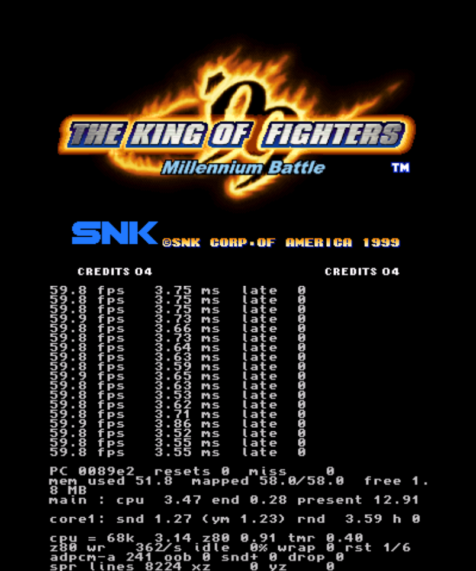

# neo3ds - NeoGeo emulator for Nintendo 3DS

*NeoGeo (Neo Geo) emulator for the Nintendo 3DS: converts MAME romsets into CIAs that run at full speed on the Old 3DS.*

**구형 3DS에서도 풀 스피드로 돌아가는 네오지오 에뮬레이터**입니다.
**런처 앱**을 한 번 설치하고, 웹 변환기로 MAME 네오지오 롬셋(zip)을 변환한 게임 파일(`.neo3ds`)을 SD 카드에 넣으면 게임 목록에서 골라 바로 실행합니다.
새 버전이 나와도 런처만 다시 설치하면 되고, 게임 파일은 그대로 씁니다. New 3DS 계열에서는 더 여유롭게 돌아갑니다.
게임마다 HOME 메뉴 아이콘을 따로 두고 싶으면 게임별 설치 파일(CIA)로 만들 수도 있습니다.

[소개 페이지](https://zzcx88.github.io/neo3ds/) · [English](README.en.md) · [웹 변환기](https://zzcx88.github.io/neo3ds/convert.html) · [오프라인 변환기 받기](https://github.com/zzcx88/neo3ds/releases/latest)

| 런처 게임 목록 (구형 3DS 실기) | 메탈슬러그 3 (구형 3DS 실기) |
|---|---|
|  |  |

## 특징

- **구형 3DS(268MHz)에서 60fps**: KOF98·KOF99·KOF2000·KOF2002·메탈슬러그·메탈슬러그 X·메탈슬러그 3·SVC Chaos·사무라이 쇼다운 5 스페셜을 실기에서 확인했습니다.
- **런처 (1.1.0)**: 런처 앱 하나를 설치하고 SD 카드에 넣은 게임 파일 목록에서 골라 실행합니다. 업데이트는 런처만 다시 설치하면 됩니다.
- **게임별 CIA도 가능**: 게임 하나를 CIA 하나로 만들면 HOME 메뉴에 게임마다 아이콘이 생기고, 런처를 거치지 않습니다.
- **퀵세이브 (1.1.0)**: 게임마다 슬롯 3개. 아래 화면 버튼이나 SELECT + L/R로 저장하고 불러옵니다.
- **서비스 메뉴와 백업 RAM (1.1.0)**: 아케이드(MVS) 바이오스의 설정 메뉴를 열 수 있고, 기판에 저장되는 설정·하이스코어가 SD 카드에 남습니다.
- **지역 선택 (1.1.0)**: 유럽·아시아 / 일본 / 미국. 일본으로 만들면 메탈슬러그의 피 표현 같은 일본판 내용이 나옵니다.
- **여러 게임 한 번에 변환 (1.1.0)**: zip 여러 개를 넣으면 변환 전에 인식된 게임 목록을 보여 주고, 한 게임이 실패해도 나머지는 계속 변환합니다.
- **풀스크린 (1.2.0)**: 키 설정의 **Screen**에서 위 화면을 가득 채우도록 늘릴 수 있습니다. 게임별로 저장됩니다.
- **아래 화면 끄기 (1.2.0)**: 아래 화면 오른쪽 위의 **⏻**로 백라이트를 끕니다. 아래 화면을 터치하면 다시 켜집니다.
- **더 빠른 그리기 (1.2.0)**: 화면을 띠 단위로 캐시 안에서 그리고 두 코어가 나눠 그려서, 풀스크린과 무거운 장면(메탈슬러그 3 등)의 프레임 드랍이 줄었습니다.
- **Linux·macOS 오프라인 변환기 (1.2.0)**: Windows에 더해 Linux x64와 macOS(Apple Silicon)용 명령줄 변환기를 받을 수 있습니다.
- **빠른 실행과 종료**: 3DS 기본 메모리 모드(64MB)로 돌아가서, 켜고 끌 때 시스템 재로딩이 없습니다.
- **MAME 롬셋 그대로 사용**: MAME 롬셋 282종을 인식하고, 그중 242종을 변환할 수 있습니다. 암호화된 후기 게임(KOF99, 가로우, 메탈슬러그 3~5, KOF2000~2003, SVC Chaos 등)은 변환할 때 해독합니다.
- **아래 화면 GUI**: 키 설정, 연사, 시스템(AES/MVS), 진단, 재시작, 서비스 메뉴, 퀵세이브, 화면 끄기를 터치 버튼으로 다룹니다. 지금 키 배치는 네오지오 버튼 색으로 보여 줍니다.
- **키 설정**: 버튼마다 네오지오 버튼이나 동시 누르기(A+B 등)를 지정하고, 게임별로 저장합니다.
- **연사(매크로)**: R + 버튼으로 켜고 끕니다. 초당 20회입니다.
- **재시작**: SELECT + START를 1초 누르면 게임을 처음부터 다시 시작합니다.
- **아이콘·배너 직접 지정**: 기본은 게임 이름으로 자동 생성하고, 웹 변환기(게임 하나 또는 여러 게임을 CIA로 만들 때)와 오프라인 변환기에서 원하는 그림으로 바꿀 수 있습니다. 여러 게임은 목록의 줄을 눌러 게임마다 따로 지정합니다.
- **한국어 / 영어** 변환기 화면을 지원합니다.

## 준비물

| | |
|---|---|
| 3DS | 구형 3DS / 2DS / New 3DS / New 2DS XL. [Luma3DS](https://github.com/LumaTeam/Luma3DS) 커스텀 펌웨어와 [FBI](https://github.com/lifehackerhansol/FBI) 같은 CIA 설치 도구가 필요합니다. |
| PC | 웹 브라우저 (Chrome·Edge·Firefox·Safari). 롬은 브라우저 안에서만 처리되고 외부로 전송되지 않습니다. [오프라인 변환기](#선택-오프라인-변환기)를 받으면 Windows 10/11 64비트 · Linux x64 · macOS(Apple Silicon)에서 인터넷 없이 변환할 수 있습니다. |
| 롬 | 직접 가진 게임의 **MAME 롬셋 zip**과 **neogeo.zip(바이오스)**. **MAME 롬셋 zip만 지원**하며, MAME 규격(롬셋 이름·칩 CRC)과 다른 롬셋은 변환되지 않습니다. 이 저장소에는 롬이 들어 있지 않습니다. |
| 사운드 | 3DS SD 카드에 `/3ds/dspfirm.cdc`가 있어야 소리가 납니다(DSP1 등으로 한 번 만들어 두면 됩니다). |

## 사용법

기본은 설치할 것이 없는 **웹 변환기**입니다. PC에 받아 두고 인터넷 없이 쓰고 싶으면 [오프라인 변환기](#선택-오프라인-변환기)도 있습니다. 두 변환기의 결과물은 같습니다.

### 1. 웹 변환기 열기
[웹 변환기](https://zzcx88.github.io/neo3ds/convert.html)를 엽니다. 설치할 것이 없습니다.

### 2. CIA 만들기

1. 게임 롬 zip과 `neogeo.zip`을 함께 끌어다 놓습니다. zip 파일 이름은 MAME 이름 그대로 두세요(`kof99.zip`, `mslug3.zip` 등). 합본 롬은 게임·부모 zip을 함께 올리세요. MAME 롬셋이 아닌 zip은 변환되지 않습니다.
2. 게임 zip을 **두 개 이상** 올리면 변환하기 전에 인식된 게임 목록이 먼저 나옵니다. 줄마다 zip 이름, 게임 이름, 변환 가능 여부와 이유(알 수 없는 롬셋·칩 누락·`neogeo.zip` 누락·지원하지 않는 카트리지)가 표시되고, 변환 가능한 게임만 변환합니다. 게임 하나만 올리면 목록 없이 바로 변환합니다. 목록의 줄을 클릭하면 그 게임의 아이콘·배너를 지정할 수 있고, 지정하지 않은 게임은 자동 생성됩니다.
3. 필요하면 **시스템**, **지역**을 바꿉니다.
   - **시스템**: 처음 켤 때 쓸 바이오스입니다(자동 = 가정용 AES, 아케이드 기판용으로 개조된 게임만 MVS). 3DS에서도 바꿀 수 있습니다.
   - **지역**: 게임이 보는 기기 지역입니다. 기본은 유럽·아시아이고, **일본**을 고르면 메탈슬러그의 피 표현처럼 일본판에만 있는 내용과 일본어가 나옵니다(게임마다 다름). neogeo.zip에 그 지역 바이오스가 없으면 다른 지역 바이오스를 쓰고 로그에 알려 줍니다.
4. CIA로 만들 때는 변환 전에 **아이콘·배너** 미리보기가 나옵니다. 게임이 여러 개면 목록의 줄을 눌러 그 게임의 아이콘·배너를 엽니다(한 번에 한 게임). 그대로 두면 게임 이름으로 자동 생성되고, **[파일 선택]** 으로 원하는 그림을 넣거나 **[자동 생성]** 으로 되돌릴 수 있습니다. 그림은 가운데를 기준으로 잘라 48×48 / 256×128로 맞춥니다. 지정한 그림은 그 게임 CIA에만 쓰입니다.
5. **[CIA 만들기]** 를 누릅니다. 게임 하나에 수십 초~1~2분쯤 걸립니다(그래픽 압축).
6. 끝나면 **[CIA 받기]** 로 저장합니다. 아래에 CIA 크기·브라우저 메모리·3DS 메모리 추정치가 표시됩니다.

변환 중에는 **진행** 섹션에 전체 진행률이 표시되고(게임이 여러 개면 완료한 게임 수 + 현재 게임의 단계 진행), **[변환하기]** 를 누르면 그 섹션으로 자동 이동합니다. 롬 zip을 확인하는 동안에는 목록 위에 zip 수 기준 인식 진행 바(인식 중 2/4)가 표시됩니다.

게임마다 진행 상태가 표시되고, 한 게임이 실패해도 나머지는 계속 변환합니다. 아이콘·배너는 변환을 시작하기 전에만 바꿀 수 있습니다. 끝나면 성공·실패 수와 함께 게임마다 받기 링크가 남고, 여러 게임을 CIA나 런처용 파일로 만들었으면 **[전체 다운로드 (N)]** 로 완료된 결과를 ZIP 하나에 받을 수 있습니다. 새로 변환을 시작하면 이전 받기 링크는 정리됩니다.

오른쪽 위 **KO/EN** 버튼으로 언어를 바꿀 수 있습니다.

자동으로 만들어지는 아이콘(약어 + 시리즈 번호)과 배너(게임 이름)의 예입니다. 글자가 잘리지 않게 크기를 맞춥니다. 원하는 그림이 있으면 변환 전에 게임마다 아이콘·배너를 바꿀 수 있습니다.


### 3. 3DS에 설치
만든 `.cia`를 SD 카드에 복사하고, 3DS에서 FBI → SD → 파일 선택 → **Install CIA**. HOME 메뉴에 게임 아이콘이 생깁니다.

### 런처로 쓰기 (게임 목록 앱)


게임마다 CIA를 설치하지 않고, 앱 하나에서 게임을 골라 실행하는 방법입니다. HOME 메뉴 아이콘이 하나만 생깁니다.

1. 웹 변환기의 **[런처 CIA]** 모드로 만든 `neo3ds-launcher.cia`를 FBI로 **한 번만** 설치합니다. Windows 오프라인 변환기 zip에도 들어 있습니다.
2. 변환기에서 **[런처용 파일]** 모드로 롬 zip을 넣고 변환하면 `.neo3ds` 파일이 나옵니다. 설정(시스템, 지역)은 CIA와 같습니다.
3. `.neo3ds` 파일을 SD 카드의 `/neo3ds/games/` 폴더에 복사합니다.
4. 런처를 켜면 게임 목록이 나옵니다. 십자키 위/아래(L/R은 한 페이지씩)로 고르거나 터치로 고르고, **A**나 **두 번 터치**로 실행합니다.
5. 게임 중에 아래 화면 **[Game list]** 를 두 번 누르면 목록으로 돌아갑니다.

같은 게임이라면 CIA로 설치한 것과 런처로 실행한 것이 키 설정, 백업 RAM, 퀵세이브를 함께 씁니다.

**업데이트는 런처만 바꾸면 됩니다.** 엔진은 런처 안에 있어서, 새 버전이 나오면 런처 CIA만 새로 설치하면 이미 만든 `.neo3ds` 파일을 다시 변환하지 않고 새 버전으로 바로 즐길 수 있습니다. 게임별 CIA는 CIA마다 엔진이 들어 있어 다시 변환해야 합니다. 키 설정과 백업 RAM은 그대로 이어지고, 퀵세이브는 버전이 바뀌면 불러올 수 없습니다.

### 선택: 오프라인 변환기

웹 변환기 대신 PC에 받아 두고 쓰는 변환기입니다. 인터넷 없이 쓸 수 있고, 파일로 보관해 둘 수 있습니다. 변환 결과는 웹 변환기와 같고, 게임 이름은 오프라인 변환기에서만 바꿀 수 있습니다. 아이콘·배너는 웹 변환기에서도 직접 지정할 수 있습니다(기본은 자동).

| PC | 받기 | 쓰는 방법 |
|---|---|---|
| Windows 10/11 64비트 | [neo3ds-converter.zip](https://github.com/zzcx88/neo3ds/releases/latest/download/neo3ds-converter.zip) | 창 + 명령줄 |
| Linux x64 | [neo3ds-converter-linux-x64.zip](https://github.com/zzcx88/neo3ds/releases/latest/download/neo3ds-converter-linux-x64.zip) (1.2.0부터, 창은 다음 릴리스부터) | 창 + 명령줄 |
| macOS (Apple Silicon) | [neo3ds-converter-osx-arm64.zip](https://github.com/zzcx88/neo3ds/releases/latest/download/neo3ds-converter-osx-arm64.zip) (1.2.0부터, 창은 다음 릴리스부터) | 창 + 명령줄 |

.NET 런타임을 따로 설치하지 않아도 됩니다. 압축을 푼 폴더는 통째로 두고, 실행 파일만 따로 꺼내지 마세요(`tools` 폴더가 함께 있어야 합니다).

#### Windows: 창으로 쓰기


1. zip을 받아 압축을 풉니다. `neo3ds-converter` 폴더에 `Neo3dsConverter.exe`, `tools` 폴더, `README.txt`, 런처 앱 `neo3ds-launcher.cia`가 들어 있습니다. 처음 실행할 때 Windows가 "알 수 없는 게시자" 경고를 띄우면 **[추가 정보] → [실행]** 을 누르세요.
2. 게임 롬 zip과 `neogeo.zip`을 **같은 폴더**에 둡니다. zip 파일 이름은 MAME 이름 그대로 두세요. MAME 롬셋이 아닌 zip은 변환되지 않습니다.
3. `Neo3dsConverter.exe`를 실행하고, 롬 zip을 창에 끌어다 놓거나 **[찾아보기...]** 를 누릅니다.
4. **롬셋** 줄에 인식된 게임이 초록색으로 나오면 변환할 수 있습니다. 필요하면 **게임 이름**, **시스템**, **지역**, **아이콘**, **배너**를 바꿉니다. 아래 미리보기가 실제 HOME 메뉴 모양입니다.
5. **[CIA 만들기]** 를 누릅니다. 런처용 파일은 **[런처용 파일 만들기]**, 런처 앱은 **[런처 CIA 만들기]** 로 만듭니다.

zip을 여러 개 한꺼번에 넣으면 차례로 변환합니다. 창 오른쪽 아래 **[English]** 버튼으로 언어를 바꿀 수 있습니다.

#### Linux·macOS: 창으로 쓰기 (다음 릴리스부터)

1. zip을 받아 압축을 풉니다. Linux는 `neo3ds-converter`를 실행하고, macOS는 `neo3ds-converter.app`을 엽니다. 인자 없이 실행하면 창이 뜨고, 인자를 주면 명령줄로 동작합니다.
2. 게임 롬 zip과 `neogeo.zip`을 **같은 폴더**에 둡니다. zip 파일 이름은 MAME 이름 그대로 두세요.
3. 롬 zip을 창에 끌어다 놓거나 **[롬 zip 열기]** 를 누릅니다(여러 개 가능).
4. 인식된 게임이 나오면 필요에 따라 **게임 이름**, **시스템**, **지역**, **아이콘**, **배너**를 바꿉니다. 아래 미리보기가 실제 HOME 메뉴 모양입니다.
5. **[CIA 만들기]** 를 누릅니다. 런처용 파일은 **[런처용 파일 만들기]**, 런처 앱은 **[런처 CIA 만들기]** 로 만듭니다. 결과는 `~/Downloads`(없으면 `~/Documents`)에 저장됩니다.
6. 창 왼쪽 위 **[English]/[한국어]** 버튼으로 언어를 바꿀 수 있습니다(창이 다시 열립니다).

zip을 여러 개 한꺼번에 넣으면 차례로 변환하고 게임마다 자동 이름·자동 아트로 만듭니다.

- **macOS**: 브라우저로 받은 파일은 실행이 막힐 수 있습니다. 압축을 푼 뒤 터미널에서 `xattr -dr com.apple.quarantine neo3ds-converter-osx-arm64`를 한 번 실행하세요. 서명하지 않은 앱이라 처음 열 때 경고가 나오면 **열기**를 누르세요.
- **Linux**: `libx11-6`, `libice6`, `libsm6`, `libfontconfig1`이 필요합니다(Ubuntu 기준). 한글 화면 글꼴은 앱에 들어 있어 별도 설치가 필요 없습니다. Wayland 네이티브는 지원하지 않고 X11/XWayland로 실행됩니다.
- **미지원**: Intel Mac, linux-arm64.

#### 명령줄로 쓰기 (Windows · Linux · macOS)

Windows는 `Neo3dsConverter.exe`, Linux·macOS는 `./neo3ds-converter`로 같은 옵션을 씁니다.

```
neo3ds-converter <게임.zip> [게임2.zip ...] [저장 폴더] [--title "이름"] [--icon 그림.png] [--banner 그림.png] [--set 롬셋] [--system aes|mvs] [--region eu|jp|us] [--pack] [--lang ko|en]
neo3ds-converter --launcher [저장 폴더]
neo3ds-converter --help
```
- zip을 여러 개 주면 차례로 변환합니다(`--title`, `--icon`, `--banner`, `--set`은 zip이 하나일 때만).
- `--set`: 합본 zip 안의 다른 판을 직접 고릅니다(예: `kof98.zip --set kof98h`).
- `--system`: 처음 켤 때 쓸 바이오스(가정용 `aes` / 아케이드 `mvs`)를 정합니다. 생략하면 자동입니다.
- `--region`: 지역(유럽·아시아 `eu` / 일본 `jp` / 미국 `us`). 생략하면 `eu`입니다.
- `--pack`: CIA 대신 런처용 `.neo3ds` 파일을 만듭니다. `--launcher`는 런처 CIA(`neo3ds-launcher.cia`)를 만듭니다.
- `--icon` / `--banner`: 아이콘(48×48)과 배너(256×128)로 쓸 그림입니다. 크기가 달라도 비율에 맞춰 잘라서 맞춥니다.
- `--lang`: 화면 언어(`ko` / `en`)를 바꿉니다. 기억해 두었다가 창을 열 때도 씁니다. (macOS 첫 실행·Linux 의존성은 위 창 쓰기 참고)

## 조작법


기본 배치입니다. 버튼은 [키 설정](#키-설정)에서 게임마다 바꿀 수 있고, 아래 화면에 지금 배치가 표시됩니다.

| 3DS | 네오지오 |
|---|---|
| 십자키 | 레버 |
| B / A / Y / X | A / B / C / D |
| SELECT | 코인 |
| START | 스타트 |
| R + B/A/Y/X | 연사 켜기/끄기 (아래 참고) |
| SELECT + L / SELECT + R | 퀵세이브 저장 / 불러오기 (아래 참고) |
| SELECT + START 1초 | 게임 재시작 |

### 아래 화면

| 버튼 | 하는 일 |
|---|---|
| **Key config** | 키 설정 화면을 엽니다 (아래 참고) |
| **Turbo** | 누를 때마다 연사 버튼이 off → A → B → X → Y 순으로 바뀌고 바로 저장됩니다 |
| **System** | 가정용(AES)과 아케이드(MVS) 바이오스를 바꿉니다. 실수 방지로 두 번 눌러야 하고, 그 바이오스로 게임이 다시 시작합니다 |
| **Diagnostics** | 진단 화면을 엽니다. 아무 데나 터치하면 돌아옵니다 |
| **Restart** | 길게 누르면(노란 막대가 다 차면) 게임을 다시 시작합니다 |
| **Service** | MVS 바이오스의 서비스 메뉴를 엽니다 (아래 참고). AES에서는 `Service: MVS only`로 표시됩니다 (런처에서는 `(MVS only)`) |
| **Slot / Save / Load** | 퀵세이브 슬롯 고르기 / 저장 / 불러오기(두 번) (아래 참고) |
| **Game list** | 런처로 실행했을 때만 나옵니다. 두 번 누르면 게임 목록으로 돌아갑니다. 이때 재시작 버튼은 `Hold: reset`으로 줄어듭니다 |
| **⏻** (LCD off) | 맨 위 오른쪽의 작은 정사각형 버튼입니다. 아래 화면 백라이트를 끕니다(배터리 절약). 아래 화면을 아무 데나 터치하면 다시 켜지고, 그 터치는 버튼으로 처리되지 않습니다. 저장되지 않고 HOME 메뉴로 나가거나 슬립에 들어가면 켜집니다 |

그 아래에 지금 키 배치가 `3DS 버튼 > 네오지오 버튼`으로 나옵니다. 네오지오 쪽은 실제 기판 버튼 색(A 빨강, B 노랑, C 초록, D 파랑)이고, START/SELECT는 기본값이면 생략합니다. 맨 위에는 게임 이름과 FPS가 나옵니다.

**재시작**: 전원을 껐다 켠 것처럼 처음부터 다시 시작합니다(기판의 세이브 데이터는 유지). SELECT와 START를 함께 1초 눌러도 되고, 두 버튼을 함께 누르는 동안에는 코인·스타트가 게임에 들어가지 않습니다.

## 키 설정


아래 화면의 **Key config**를 누르면 게임이 멈추고 설정 화면이 열립니다.

- A / B / X / Y / L / R / ZL / ZR / START / SELECT 각각에 **네오지오 A~D, 동시 누르기(A+B, C+D, B+C, A+B+C, B+C+D, A+B+C+D), 스타트, 코인**을 지정할 수 있습니다. 예를 들어 KOF에서 L = A+B(회피), R = C+D(날리기).
- 줄 오른쪽의 `<` `>`를 누르거나, 십자키 위/아래로 줄을 고르고 좌/우(또는 A)로 바꿉니다. **연사 버튼**도 여기서 정할 수 있습니다.
- **B** 또는 `Save (B)`로 저장하고 게임으로 돌아갑니다. `Default`는 기본 배치로 되돌립니다.
- **System**: 가정용(AES)과 아케이드(MVS) 바이오스를 바꿉니다(아래 화면의 System 버튼과 같음). 저장하면 그 바이오스로 게임이 다시 시작합니다. MVS에서는 SELECT로 코인을 넣어야 시작하고, 켤 때 바이오스의 초록색 점검 화면이 잠깐 보입니다. neogeo.zip에 한쪽 바이오스만 있으면 `only`로 표시되고 바꿀 수 없습니다.
- **Screen**: 위 화면 표시 방식입니다. `Original (1:1)`은 304×224 그대로 가운데에(좌우·위아래 검은 여백), `Full (stretched)`는 위 화면 400×240을 가득 채우도록 늘립니다. 가로가 약 1.3배, 세로가 약 1.07배로 늘어나서 동그란 것이 옆으로 조금 넓어 보이고, 정수배가 아니라 일부 도트가 두 배 폭으로 보입니다.
- 설정은 **게임마다** SD 카드의 `/3ds/neo3ds/keys/`에 저장되어, 껐다 켜도 유지됩니다.

## 연사(매크로)


- 아래 화면의 **Turbo** 버튼으로 바꾸거나(저장됨), **R을 누른 채 A/B/X/Y 중 하나**를 누르면 그 버튼이 연사 버튼이 됩니다.
- R을 누른 채 **같은 버튼을 다시** 누르면 꺼지고, **다른 버튼**을 누르면 그 버튼으로 바뀝니다. 연사 버튼은 한 번에 하나입니다.
- 연사 버튼을 **누르고 있는 동안** 초당 20회로 눌렀다 뗐다 합니다. 한 번씩 톡톡 누르면 평소처럼 한 발씩 나갑니다.
- 아래 화면에 지금 상태가 `Turbo: A` / `Turbo: off`로 표시됩니다.
- R을 누르고 있는 동안에는 A/B/X/Y가 게임에 전달되지 않아, 설정하다가 캐릭터가 움직이지 않습니다.
- R + 버튼으로 바꾼 연사는 그 판에만 적용됩니다. 계속 쓰려면 키 설정에서 정하세요. R에 다른 기능을 지정하면 연사는 키 설정에서만 바꿀 수 있습니다.

## 퀵세이브

게임마다 슬롯 3개에 지금 상태를 그대로 저장하고 불러옵니다.

- **Slot**: 누를 때마다 슬롯 1 → 2 → 3으로 바뀌고, 아래 상태 줄에 그 슬롯의 저장 시각이 나옵니다(`Slot 2: 10-18 14:05 AES`, 비었으면 `empty`).
- **Save**: 고른 슬롯에 저장합니다. **Load**: 실수 방지로 두 번 눌러야 불러옵니다.
- 버튼 대신 **SELECT + L**(저장), **SELECT + R**(불러오기)도 됩니다. 이때 SELECT·L·R은 게임에 들어가지 않습니다.
- 다른 바이오스(AES/MVS)에서 저장한 슬롯을 불러오면 그 바이오스로 바꾼 뒤 불러옵니다.
- 슬롯은 껐다 켜도 남습니다. 다만 **neo3ds 버전이 바뀌면 이전 버전의 슬롯은 불러올 수 없습니다**(`from another version`). 백업 RAM(아래)은 버전과 관계없이 유지됩니다.

## 서비스 메뉴와 백업 RAM

- 아케이드(MVS) 바이오스로 실행 중일 때 아래 화면 **Service**를 누르면 기판의 테스트 스위치를 누른 것과 같아서, 바이오스의 서비스 메뉴(난이도·크레딧 같은 게임 설정, 하드웨어 테스트 등)가 열립니다.
- MVS 기판의 **백업 RAM**(게임 설정, 하이스코어, 랭킹 이니셜 등)을 SD 카드에 저장합니다. 바뀌었을 때만 쓰고, HOME 메뉴로 나가거나 닫거나 절전할 때도 바로 저장합니다.

## 저장 위치

| 파일 | SD 카드 경로 |
|---|---|
| 키 설정 | `/3ds/neo3ds/keys/<타이틀 ID>.bin` |
| 백업 RAM | `/3ds/neo3ds/saves/<타이틀 ID>.sram` |
| 퀵세이브 | `/3ds/neo3ds/states/<타이틀 ID>.1` ~ `.3` |
| 런처용 게임 파일 | `/neo3ds/games/*.neo3ds` |

타이틀 ID는 롬셋 이름(zip 이름)으로 정해지므로, 같은 zip으로 다시 만들거나 런처로 실행해도 같은 파일을 씁니다.

## 진단 화면



아래 화면의 **Diagnostics**를 누르면 1초마다 FPS, 메인 코어 시간(68000·Z80·타이머), 코어 1 시간(사운드·그리기), 메모리 사용량을 보여 줍니다. 아무 데나 터치하면 버튼 화면으로 돌아갑니다.

## 게임 호환성


### 실기(구형 3DS)에서 확인한 게임

| 게임 | 롬셋 | 결과 |
|---|---|---|
| The King of Fighters '98 | `kof98` (가정용 `kof98h`로 변환) | 풀 스피드, 대전 중 프레임 드랍 없음 |
| The King of Fighters '99 | `kof99` (SMA + CMC42 해독) | 풀 스피드 |
| Metal Slug | `mslug` | 풀 스피드 (1.1.0에서 배경음악이 처지던 문제 수정) |
| Metal Slug 2 | `mslug2` | 플레이 가능. 원래 기판에서 느려지는 장면은 똑같이 느려짐 |
| Metal Slug X | `mslugx` (보호 칩 검사 패치) | 풀 스피드. 원래 기판에서 느려지는 장면은 똑같이 느려짐 |
| Metal Slug 3 | `mslug3` (SMA + CMC42 해독) | 풀 스피드. 원래 기판에서 느려지는 장면은 똑같이 느려짐 |
| The King of Fighters 2000 | `kof2000` (SMA + CMC50 해독) | 풀 스피드 |
| The King of Fighters 2002 | `kof2002` (PCM2 + CMC50 해독) | 풀 스피드 |
| SNK vs. Capcom: SVC Chaos | `svc` (PVC + PCM2 + CMC50 해독) | 풀 스피드 |
| SNK vs. Capcom: SVC Chaos Plus | `svcplus` (해적판. 파이트케이드에서 많이 쓰는 판) | 풀 스피드. MVS 바이오스로 시작 |
| Samurai Shodown V Special | `samsh5sp` (KOF2002형 + PCM2 + CMC50 해독) | 풀 스피드 (1.0.5부터. 줌 아웃 장면 최적화) |
| Aero Fighters 3 | `sonicwi3` | 플레이 가능 (1.1.0에서 음악이 몇 초 뒤 멈추던 문제 수정) |
| The King of Fighters 2003 | `kof2003` (PVC + PCM2 + CMC50 해독) | 60fps (유저 제보) |
| Metal Slug 5 | `mslug5` (PVC + PCM2 + CMC50 해독) | 60fps (유저 제보) |
| Garou: Mark of the Wolves | `garou` (SMA + CMC42 해독) | 60fps (유저 제보) |

메탈슬러그 2·X·3은 원래 아케이드 기판에서도 적과 폭발이 많은 장면에서 느려지는(처리 지연) 게임입니다. neo3ds에서도 그 구간에서는 똑같이 프레임이 떨어지며, PC 에뮬레이터에서도 같은 곳에서 느려집니다.

### 변환은 되지만 실기에서 확인하지 못한 게임
- **암호화 없는 게임 대부분** (1990~1999년 게임): KOF94~97, 아랑전설 시리즈(2편 제외), 사무라이 쇼다운 1~4, 월드 히어로즈, 라스트 블레이드 1·2, 블레이징 스타, 퍼즐 보블 등. 위 확인 게임과 같은 방식으로 변환됩니다.
- **해독은 구현했지만 롬이 없어 돌려 보지 못한 방식**
  - CMC42: 전국전승 3, 줏파파, 스트라이커즈 1945 플러스, 프리히스토릭 아일 2, 나이트메어 인 더 다크, 간류, 뱅 비드
  - CMC50: KOF2001
  - PCM2: 메탈슬러그 4 / 4 플러스, 레이지 오브 드래곤즈, 포치와 냐
  - KOF2002 계열(KOF2002, 사무라이 쇼다운 5 스페셜은 실기 확인): 2002 플러스, 사무라이 쇼다운 5, 매트리멜리

메모리 사용량은 롬 크기가 거의 같은 KOF99·메탈슬러그 3과 비슷할 것으로 예상합니다(58MB 중 약 53MB). 변환기는 메모리가 빠듯하면 경고를 띄웁니다.

### 변환할 수 없는 게임

| 이유 | 롬셋 |
|---|---|
| 보호 칩 미지원 | 아랑전설 2 (`fatfury2`), 슈퍼 사이드킥스 (`ssideki`) |
| MVS판 보호 칩 | KOF98 MVS판 (`kof98`, `kof98a`, `kof98k`, `kof98ka`). 합본 `kof98.zip`이면 가정용판 `kof98h`로 자동 변환됩니다 |
| 전용 컨트롤러 | 더 이리테이팅 메이즈 (`irrmaze`, 트랙볼) |
| 도박 기판 | V-Liner (`vliner` 계열), 자키 그랑프리 (`jockeygp` 계열) |
| 해적판(부트렉) | `kof10th`, `kf2k2mp`, `kof2002b`, `cthd2003`, `ms5plus`, `svcboot`, `svcplusa`, `kf2k3bl`, `mslug3b6`, `kog`, `sbp` 등 27종 (해적판 중 `svcplus`만 지원) |

이 밖에 마작 게임은 마작 패널 입력이 없어서 제대로 즐기기 어렵고, 4인용(`kizuna4p`)은 2인까지만 됩니다.

## 배터리 사용 시간

구형 3DS에 CameronSino 1300mAh 서드파티 배터리를 끼우고 메탈슬러그 3을 돌려 잰 값입니다. 한 번 잰 결과라 대략적인 참고용입니다.

| 조건 | 1시간 소모량 | 완충 기준 | |
|---|---|---|---|
| 밝기 3(중간), 무선 끔, 절전 모드 끔, 음량 중간 | 19.5% (95% → 75.5%) | 약 5시간 | 실측 + 추정 |
| 밝기 최대, 무선 켬 | – | 약 3~4시간 | 추정 |

- 1시간 소모량은 실측값이고, 완충 기준 시간은 이 소모량으로 단순 계산한 값입니다. 배터리 표시는 바닥 근처에서 천천히 줄어들어서 실제로는 조금 더 갈 수 있습니다.
- 같은 배터리로 배터리 벤치(밝기 최대, 3D 켬, 무선 켬)를 돌렸을 때는 95%에서 5%까지 2시간이 걸렸습니다. neo3ds를 돌릴 때 배터리 표시가 줄어드는 속도는 이 벤치의 절반에 조금 못 미칩니다.
- 밝기 최대·무선 켬은 측정하지 않았고, 그 차이만큼의 전력을 더해 어림한 값입니다.
- GPU를 쓰지 않고, 남는 시간에는 두 코어 모두 쉬며, 게임 중에는 백업 RAM이 바뀌었을 때와 퀵세이브할 때만 SD 카드에 씁니다. (측정은 1.0.x에서 했습니다.) 3D 슬라이더를 올려도 2D로만 출력합니다.
- 게임, 배터리 상태와 용량에 따라 달라질 수 있습니다.

## 64MB 모드와 최적화

구형 3DS의 CPU는 268MHz ARM11 두 개뿐이고, 앱이 쓸 수 있는 메모리는 기본 모드에서 64MB입니다.
80MB 모드를 쓰면 메모리는 넉넉해지지만, 게임을 켜고 끌 때마다 시스템을 다시 불러와서 무척 느려집니다.
그래서 **기본 64MB 모드 안에 64MB짜리 그래픽 롬을 넣는 것**을 목표로 했습니다.

### 메모리
- **그래픽 압축**: 스프라이트 롬(최대 64MB)을 4KB 블록 단위 zstd(레벨 19)로 압축합니다. 원본의 약 30%가 됩니다(KOF99 64MB → 19.6MB).
- **8MB 블록 캐시**: 화면에 필요한 블록만 풀어서 캐시에 둡니다. 사용 여부 표로 완전히 투명한 타일은 아예 읽지 않습니다.
- **힙 배치**: 일반 힙 58MB, 그래픽용 linear 메모리 2MB로 나눴습니다. KOF99 기준 51.5MB를 씁니다.
- **변환 시 해독**: 암호화된 롬은 PC에서 미리 풀어 둡니다. 3DS에서는 해독에 메모리도 시간도 쓰지 않습니다.

### 속도
- **두 코어 분담**: 메인 코어는 68000·Z80·타이머만 돌리고, 사운드 합성과 화면 그리기는 두 번째 코어가 맡습니다.
- **사운드 칩 분리**: YM2610을 둘로 나눴습니다. 메인 코어 쪽은 타이머·인터럽트·상태만 처리하고, 두 번째 코어 쪽은 기록된 레지스터 쓰기를 재생하며 소리를 만듭니다.
- **스프라이트 렌더러**: 확대·축소가 없는 스프라이트는 타일 단위로 그리고, 불투명한 8픽셀은 ARM 어셈블리로 한 번에 씁니다. 가로로 축소된 줄은 줌 단계(16)×좌우 반전(2)마다 컴파일 때 펼쳐 둔 전용 코드로 그려서, 줌 아웃이 많은 게임(사무라이 쇼다운)도 빠르게 그립니다. 3DS 화면 방향(세로로 회전된 프레임버퍼)과 같은 형태로 그립니다.
- **화면 출력**: GPU 대신 CPU가 그립니다. 화면을 14줄짜리 띠 16개로 나눠 캐시에 들어가는 작은 버퍼에 그린 뒤 프레임버퍼에 한 번만 쓰고(풀스크린 확대도 이때), 코어 0이 먼저 끝나면 남은 띠를 나눠 그립니다. 3중 버퍼로 찢어짐 없이 내보냅니다. 캐시 정리는 시스템 서비스 대신 SVC를 직접 불러서, 두 번째 코어가 시스템 서비스를 기다리느라 멈추지 않습니다. 아래 화면 GUI도 CPU가 그리되, 버튼을 누르는 등 바뀔 때만 다시 그려서 게임 중에는 비용이 거의 없습니다.
- **표시 영역**: 네오지오 실제 표시 폭인 304×224만 그립니다.
- **프레임 페이싱**: 조금 늦은 프레임이 한 프레임을 통째로 잃지 않도록, 이미 지난 vblank는 기다리지 않습니다.
- **사운드 드라이버 대기 건너뛰기**: 메탈슬러그 2·X·3의 Z80이 인터럽트를 기다리며 도는 루프를 결과가 똑같게 건너뜁니다.
- **바이오스**: neogeo.zip에 가정용(AES) 바이오스가 있으면 그것을, 없으면 업소용(MVS) 바이오스를 씁니다. 고른 지역의 바이오스를 먼저 찾습니다.

New 3DS에서는 804MHz와 L2 캐시가 켜지도록 설정해 두어서 훨씬 여유롭습니다(실기 미확인).

측정값, 시행착오, 버그를 찾은 방법까지 담은 자세한 설명은 [기술 문서](docs/TECHNICAL.ko.md)에 있습니다.

## 직접 빌드하기

- 엔진: [devkitPro](https://devkitpro.org/)(devkitARM, libctru). `bash scripts/build_engine.sh` → `engine/engine.elf`
- 웹 변환기: emsdk. `bash scripts/build_wasm.sh` → `site/vendor/` (WASM 3종 + 정적 자산) 후 `site/`를 정적 서버로
- C# 변환기(Windows exe·기준선): .NET 10 SDK. `dotnet build -c Release converter/Neo3dsConverter`
- 게임 DB 갱신: MAME `src/mame/snk/neogeo.cpp`를 받아 `py scripts/gen_gamedb.py neogeo.cpp converter/assets/neogeo_games.json`

## 법적 고지

- 이 저장소와 배포 파일에는 **롬, 바이오스, 게임 데이터가 들어 있지 않습니다.** 변환에는 본인이 가진 게임의 롬이 필요합니다.
- 변환해서 만든 CIA에는 롬 데이터가 들어 있으므로 **다른 사람에게 배포하지 마세요.**
- neo3ds는 **비상업적 용도로만** 쓸 수 있습니다. 포함된 CPU 코어(Cyclone 68000, DrZ80)가 비상업적 사용만 허락하기 때문입니다.
- 소스 코드는 GPL-2.0입니다([LICENSE](LICENSE)). 포함된 외부 코드와 라이선스는 [THIRD_PARTY_NOTICES.md](THIRD_PARTY_NOTICES.md)에 있습니다.
- NEOGEO, SNK는 SNK CORPORATION의 상표이고, Nintendo 3DS는 Nintendo의 상표입니다. neo3ds는 개인 팬 프로젝트이며 이들과 관계가 없습니다. 스크린샷과 영상 속 게임 화면의 저작권은 각 권리자에게 있습니다.

## 고마운 분들

gngeo(Peponas Mathieu), Cyclone 68000(Dave, notaz), DrZ80(Reesy), MAME 개발팀(롬셋 정보와 카트 해독 연구), Zstandard, devkitPro / libctru, makerom, bannertool, Azahar(개발 중 테스트).
