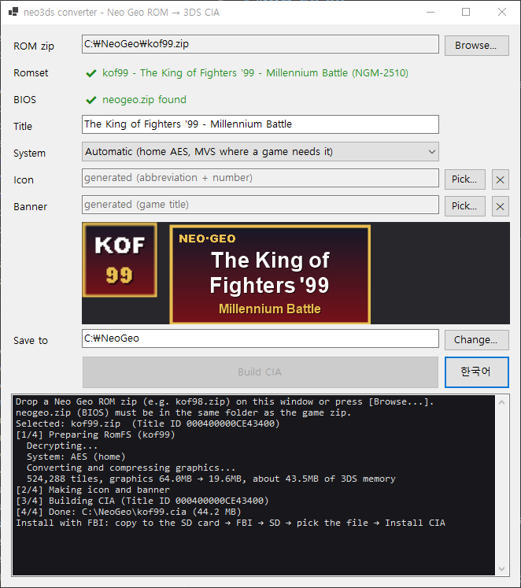

# neo3ds - NeoGeo emulator for Nintendo 3DS

**Neo Geo games at full speed on the original (Old) 3DS.** Convert your MAME romsets in the browser, copy them to the SD card, and play from a game list.

[Project page](https://zzcx88.github.io/neo3ds/) · [**Web converter**](https://zzcx88.github.io/neo3ds/convert.html) · [Releases](https://github.com/zzcx88/neo3ds/releases/latest) · [Compatibility list](https://zzcx88.github.io/neo3ds/compat.html) · [한국어](README.ko.md)

| Launcher game list (Old 3DS hardware) | Metal Slug 3 (Old 3DS hardware) |
|---|---|
|  |  |

## Why neo3ds

- **60 fps on a 268 MHz Old 3DS.** KOF '95-2002, Metal Slug 1/X/3/5, SVC Chaos and Samurai Shodown V Special run at full speed on hardware, with no frame skipping.
- **Starts and quits instantly.** Everything fits in the 3DS's default 64 MB memory mode, so the system never reloads when a game starts or exits.
- **Nothing to install on the PC.** The web converter runs in your browser and your ROMs never leave it. Offline converters for Windows, Linux and macOS are there if you want one.
- **Plain MAME romsets.** 242 of the 282 MAME Neo Geo romsets convert, including the encrypted later games (KOF99-2003, Garou, Metal Slug 3-5, SVC Chaos), which are decrypted during conversion.
- **One launcher, update once.** Install the launcher app, drop `.neo3ds` game files on the SD card, and update by reinstalling only the launcher. Or build one CIA per game with its own HOME menu icon.
- **Made for a handheld.** Quick save, per-game key config with button combos, turbo, full screen, a bottom-screen backlight switch and the arcade BIOS service menu, all from touch buttons on the bottom screen.

**New in 1.3.0**: launcher favorites, mid-screen raster effects (Neo Turf Masters, Neo Drift Out), windowed converters for Linux and macOS, faster conversion. [Release notes](https://github.com/zzcx88/neo3ds/releases/tag/v1.3.0)

## Quick start

1. **Prepare the 3DS**: [Luma3DS](https://github.com/LumaTeam/Luma3DS) custom firmware, a CIA installer such as [FBI](https://github.com/lifehackerhansol/FBI), and `/3ds/dspfirm.cdc` on the SD card for sound (dump it once with DSP1).
2. **Get the launcher**: in the [web converter](https://zzcx88.github.io/neo3ds/convert.html), build the launcher CIA and install it with FBI. You do this once.
3. **Convert your games**: drop your MAME romset zips together with `neogeo.zip` (BIOS) and build **launcher files** (`.neo3ds`).
4. **Play**: copy the `.neo3ds` files to `/neo3ds/games/` on the SD card and start the launcher.

You need MAME romset zips of games you own, plus `neogeo.zip`. No ROMs are included here. A romset whose file names or chip CRCs differ from MAME's does not convert.

## Converting

### Web converter (recommended)

Works in Chrome, Edge, Firefox and Safari. Converting KOF '98 took about 7 seconds on our test PC.

1. Open the [web converter](https://zzcx88.github.io/neo3ds/convert.html) and drop the game zip(s) with `neogeo.zip`. Keep the MAME file names (`kof99.zip`, `mslug3.zip`...). For merged sets, drop the parent zip too.
2. With several zips, a list shows what was recognized and why anything can't be converted (unknown romset, missing chips, missing `neogeo.zip`, unsupported cart). Only convertible games are converted; one failure does not stop the rest.
3. Pick the output: **Launcher file** (`.neo3ds`), **CIA** (one HOME menu app per game) or **Launcher CIA** (the launcher app itself).
4. Change **System** or **Region** if you like:
   - **System** is the BIOS the game starts on. Automatic picks the home (AES) BIOS; arcade (MVS) is only for games changed for arcade boards. It can be switched on the 3DS too.
   - **Region** is the console region the game sees (Europe/Asia by default). **Japan** gives content only the Japanese versions have, such as the blood in Metal Slug.
5. For CIAs you can replace the generated **icon and banner** before converting (select a game row to edit that game). Pictures are centre-cropped to 48×48 / 256×128.
6. Press the build button and save the results, one by one or with **[Download all (N)]** as one ZIP.


### Offline converter (optional)

The same converter as a program on your PC, with a window and a command line. It also lets you change the game **title**. No .NET runtime to install; keep the unpacked folder together.

| PC | Download |
|---|---|
| Windows 10/11 64-bit | [neo3ds-converter.zip](https://github.com/zzcx88/neo3ds/releases/latest/download/neo3ds-converter.zip) |
| Linux x64 | [neo3ds-converter-linux-x64.zip](https://github.com/zzcx88/neo3ds/releases/latest/download/neo3ds-converter-linux-x64.zip) |
| macOS (Apple Silicon) | [neo3ds-converter-osx-arm64.zip](https://github.com/zzcx88/neo3ds/releases/latest/download/neo3ds-converter-osx-arm64.zip) |



1. Unzip and run `Neo3dsConverter.exe` (Windows), `neo3ds-converter` (Linux) or `neo3ds-converter.app` (macOS).
2. Drop game zips on the window (keep `neogeo.zip` in the same folder) or open them with the browse button.
3. When the romset shows as recognized, change the title, system, region, icon or banner if you like; the preview shows the HOME menu art.
4. Build a **CIA**, a **launcher file** or the **launcher CIA**. Windows saves next to the zip; Linux and macOS save to `~/Downloads`.

The language button switches between Korean and English.

<details>
<summary>First run on each OS</summary>

- **Windows**: on an "unknown publisher" warning, click **[More info] → [Run anyway]**.
- **macOS**: after unzipping, run `xattr -dr com.apple.quarantine neo3ds-converter-osx-arm64` once in Terminal. The app is unsigned, so press **Open** if a warning appears.
- **Linux**: needs `libx11-6`, `libice6`, `libsm6`, `libfontconfig1` (Ubuntu names). Verified on Xubuntu 26.10 (X11). Icon and banner titles in Korean use the system font, so install a Korean font such as `fonts-noto-cjk`. Runs on X11/XWayland; native Wayland is not supported.
- **Not supported**: Intel Macs, linux-arm64.

</details>

<details>
<summary>Command line</summary>

The same options work with `Neo3dsConverter.exe` on Windows and `./neo3ds-converter` on Linux and macOS.

```
neo3ds-converter <game.zip> [game2.zip ...] [out-dir] [--title "Name"] [--icon pic.png] [--banner pic.png] [--set romset] [--system aes|mvs] [--region eu|jp|us] [--pack] [--lang ko|en]
neo3ds-converter --launcher [out-dir]
neo3ds-converter --help
```

- Several zips are converted one after the other (`--title`, `--icon`, `--banner` and `--set` need a single zip).
- `--set` picks another version inside a merged zip (e.g. `kof98.zip --set kof98h`).
- `--system`: home `aes` / arcade `mvs`; automatic when left out.
- `--region`: Europe/Asia `eu`, Japan `jp` or USA `us`; `eu` when left out.
- `--pack` builds a `.neo3ds` file instead of a CIA. `--launcher` builds `neo3ds-launcher.cia`.
- `--icon` / `--banner`: 48×48 icon and 256×128 banner; other sizes are scaled and cropped.
- `--lang`: `ko` / `en`, remembered for the window too.

</details>

## On the 3DS

### Launcher


- Pick a game with Up/Down (L/R for a page) or by touch; start it with **A** or a **double tap**.
- **Favorites**: **SELECT** or a tap on the `*` at the left of a game adds or removes it. Left/Right or a tap on the tabs switches between **All** and **Fav**.
- In a game, tap **[Game list]** on the bottom screen twice to go back.

**Updating only takes the launcher.** The engine lives in the launcher, so the `.neo3ds` files you already made run on a new version as they are. Per-game CIAs carry their own engine and have to be converted again. Key configs and backup RAM carry over; quick saves from another version can't be loaded.

To use per-game CIAs instead, copy the `.cia` to the SD card and install it in FBI (SD → the file → **Install CIA**). A game shares its key config, backup RAM and quick saves between its CIA and the launcher.

### Controls


| 3DS | Neo Geo |
|---|---|
| D-pad | Joystick |
| B / A / Y / X | A / B / C / D |
| SELECT / START | Coin / Start |
| R + B/A/Y/X | Turbo on/off |
| SELECT + L / SELECT + R | Quick save / quick load |
| Hold SELECT + START for 1 s | Restart the game |

These are the defaults; [Key config](#key-config) changes them per game. The bottom screen shows the current layout in the arcade panel colours (A red, B yellow, C green, D blue), with the game title and fps at the top.

### Bottom screen

| Button | What it does |
|---|---|
| **Key config** | Opens the key config screen (the game pauses) |
| **Turbo** | Each tap moves turbo off → A → B → X → Y |
| **System** | Switches between the home (AES) and arcade (MVS) BIOS. Tap twice; the game restarts on it |
| **Diagnostics** | fps, per-core time and memory use, once a second. Touch to go back |
| **Restart** | Hold until the yellow bar fills. Like switching the console off and on (cartridge saves are kept) |
| **Service** | Opens the MVS BIOS service menu (difficulty, credits, hardware tests). MVS only |
| **Slot / Save / Load** | Quick save: pick slot 1-3, save, load (tap twice) |
| **Game list** | From the launcher only: tap twice to go back to the list |
| **⏻** | Turns the bottom screen's backlight off; touch anywhere to turn it back on (that touch presses nothing) |

### Key config


- A / B / X / Y / L / R / ZL / ZR / START / SELECT can each press **Neo Geo A-D, a combination (A+B, C+D, B+C, A+B+C, B+C+D, A+B+C+D), Start or Coin**. For example in KOF: L = A+B (dodge), R = C+D (blowback).
- Change a line with the `<` `>` at its end, or Up/Down then Left/Right. The turbo button is set here too.
- **System** switches the BIOS (saving restarts the game). On MVS, press SELECT for a coin before starting.
- **Screen**: `Original (1:1)` shows the 304×224 picture as is; `Full (stretched)` fills the 400×240 top screen (about 1.3× wider, 1.07× taller, so some pixels show twice as wide).
- **B** or `Save (B)` saves and returns; `Default` restores the defaults. Settings are kept per game.


**Turbo**: hold R and press A, B, X or Y to make it the turbo button (the same button again turns it off). Held down, it fires 20 times a second; single taps still fire once. R + button lasts for the session; set it in Key config to keep it.

**Quick save**: three slots per game hold the exact game state. A slot saved on the other BIOS switches to it before loading.

**Backup RAM**: on the MVS BIOS, the board's settings, high scores and ranking initials are saved to the SD card when they change, and straight away on HOME, close or sleep.

<details>
<summary>Where things are saved</summary>

| File | SD card path |
|---|---|
| Key config | `/3ds/neo3ds/keys/<title ID>.bin` |
| Backup RAM | `/3ds/neo3ds/saves/<title ID>.sram` |
| Quick saves | `/3ds/neo3ds/states/<title ID>.1` to `.3` |
| Launcher game files | `/neo3ds/games/*.neo3ds` |
| Launcher favorites | `/3ds/neo3ds/launcher.txt` |

The title ID comes from the romset (zip) name, so rebuilding from the same zip or starting the game from the launcher uses the same files.

</details>

## Compatibility


The [compatibility list](https://zzcx88.github.io/neo3ds/compat.html) shows all 282 romsets. Games played on an Old 3DS:

| Game | Romset | Result |
|---|---|---|
| The King of Fighters '95 | `kof95` | Full speed |
| The King of Fighters '96 | `kof96` | Full speed |
| The King of Fighters '97 | `kof97` | Full speed |
| The King of Fighters '98 | `kof98` (converted as the home version `kof98h`) | Full speed, no drops in fights |
| The King of Fighters '99 | `kof99` | Full speed |
| The King of Fighters 2000 | `kof2000` | Full speed |
| The King of Fighters 2002 | `kof2002` | Full speed |
| SNK vs. Capcom: SVC Chaos | `svc` | Full speed |
| SNK vs. Capcom: SVC Chaos Plus | `svcplus` (bootleg; the set Fightcade players use) | Full speed; starts on the MVS BIOS |
| Samurai Shodown V Special | `samsh5sp` | Full speed |
| Metal Slug | `mslug` | Full speed |
| Metal Slug X | `mslugx` (protection checks patched) | Full speed; slows down where the original board does |
| Metal Slug 3 | `mslug3` | Full speed; slows down where the original board does |
| Metal Slug 5 | `mslug5` | Full speed |
| Metal Slug 2 | `mslug2` | Playable; slows down where the original board does |
| Aero Fighters 3 | `sonicwi3` | Playable |
| Neo Turf Masters | `turfmast` | Full speed; the water shows from 1.3.0 |
| Neo Drift Out | `neodrift` | Full speed; stage starts and curves draw correctly from 1.3.0 |
| The King of Fighters 2003 | `kof2003` | 60 fps (user report) |
| Garou: Mark of the Wolves | `garou` | 60 fps (user report) |
| Metal Slug 4 | `mslug4` | Plays fine (user report) |
| Neo Bomberman, Street Hoop, Shock Troopers, Top Hunter | `neobombe`, `strhoop`, `shocktro`, `tophuntr` | Play fine (user report) |

Metal Slug 2, X and 3 slow down on the original arcade board too, in scenes with many enemies and explosions; neo3ds drops frames in the same places, as PC emulators do.

**Converts, not tried on hardware**: most other games, such as KOF '94, Fatal Fury, Samurai Shodown 1-4, World Heroes, The Last Blade 1/2, Blazing Star and Puzzle Bobble. Decryption for Sengoku 3, Zupapa!, Strikers 1945 Plus, KOF2001, Metal Slug 4 Plus, Rage of the Dragons, Samurai Shodown V, Matrimelee and others is implemented but never run.

| Can't be converted | Romsets |
|---|---|
| Protection chip not supported | Fatal Fury 2 (`fatfury2`), Super Sidekicks (`ssideki`) |
| MVS protection chip | KOF98 MVS sets (`kof98`, `kof98a`, `kof98k`, `kof98ka`). A merged `kof98.zip` converts as `kof98h` automatically |
| Special controller | The Irritating Maze (`irrmaze`, trackball) |
| Gambling boards | V-Liner (`vliner` sets), Jockey Grand Prix (`jockeygp` sets) |
| Bootlegs | 27 sets (only `svcplus` is supported) |

Mahjong games lack mahjong panel input, and the 4-player `kizuna4p` plays with two players.

## How it runs at full speed

An Old 3DS has two 268 MHz ARM11 cores and gives apps 64 MB in its default memory mode. The 80 MB mode has more room but reloads the system every time a game starts or exits, so neo3ds fits Neo Geo games with up to 64 MB of graphics into the default mode.

- **Compressed graphics**: the sprite ROM is zstd-compressed in 16 KB blocks to about 30% (KOF '98: 64 MB → 20.3 MB). An 8 MB cache unpacks only the blocks on screen, and fully transparent tiles are never read.
- **Decrypted ahead of time**: encrypted ROMs are decrypted on the PC, costing the 3DS neither memory nor time.
- **Two cores**: the main core runs the 68000, Z80 and timers; the second core makes the sound and draws the screen. The YM2610 sound chip runs as two copies, one for timers and interrupts and one replaying the register writes into sound.
- **Fast sprite drawing**: opaque 8-pixel runs are written by ARM assembly straight into the 3DS's rotated framebuffer, and shrunk rows use code unrolled for each of the 16 zoom steps.
- **Cache-sized bands**: the screen is drawn in 16 bands of 14 lines that fit the CPU cache, shared by both cores, with triple buffering so it never tears.
- **Battery**: no GPU work, idle cores sleep, and the SD card is written only for saves. Metal Slug 3 used 19.5% of a 1300 mAh battery per hour at middle brightness with Wi-Fi off (about 5 hours from a full charge; one measured run).

New 3DS models run at 804 MHz with the L2 cache on, for plenty of headroom (not tested on hardware). The [technical write-up](docs/TECHNICAL.md) covers the measurements, what was tried and dropped, and how bugs were found.

## Building from source

- Engine: [devkitPro](https://devkitpro.org/) (devkitARM, libctru). `bash scripts/build_engine.sh` → `engine/engine.elf`
- Web converter: emsdk. `bash scripts/build_wasm.sh` → `site/vendor/`, then serve `site/` statically
- Offline converter: .NET 10 SDK. `dotnet build -c Release converter/Neo3dsConverter` (Windows) or `converter/Neo3dsConverter.Desktop` (Linux, macOS)
- Game DB: fetch MAME's `src/mame/snk/neogeo.cpp` and run `py scripts/gen_gamedb.py neogeo.cpp converter/assets/neogeo_games.json`

## Legal

- This repository and its releases contain **no ROMs, BIOS or game data**. You need ROMs of games you own.
- The CIAs and `.neo3ds` files you build contain ROM data: **do not share them.**
- neo3ds is for **non-commercial use only**, because its CPU cores (Cyclone 68000, DrZ80) are licensed for non-commercial use only.
- The source code is GPL-2.0 ([LICENSE](LICENSE)). Third-party code and licenses are listed in [THIRD_PARTY_NOTICES.md](THIRD_PARTY_NOTICES.md).
- NEOGEO and SNK are trademarks of SNK CORPORATION; Nintendo 3DS is a trademark of Nintendo. neo3ds is an independent fan project, not affiliated with either. Game footage and screenshots belong to their respective owners.

## Thanks

gngeo (Peponas Mathieu), Cyclone 68000 (Dave, notaz), DrZ80 (Reesy), the MAME team (romset data and cart decryption research), Zstandard, devkitPro / libctru, makerom, bannertool, and Azahar (testing during development).
